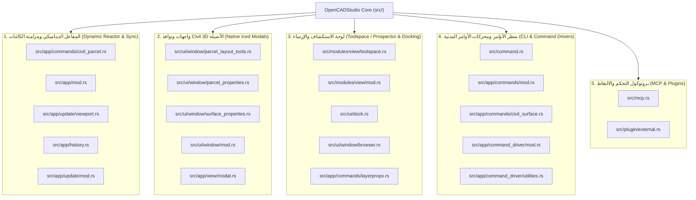

# التقرير الفني الشامل لتعديلات النواة البرمجية (OpenCADStudio Core Modifications Report)

> **الإصدار المستهدف:** OpenCADStudio v2026.41.0 (Engine Build)  
> **لغة التطوير:** 100% Native Rust (Iced GUI framework, Elm/MVU Architecture)  
> **تاريخ التوثيق:** 17 أكتوبر 2026  
> **نطاق التعديل:** 22 ملفاً داخل نواة المحرك ومكتبات النظم (`src/`)

---

## 1. الفهرس التنفيذي للملفات المعدلة في الـ Core

تم تعديل وتطوير **22 ملفاً أصيلاً** داخل شجرة المصدر `src/` لتزويد OpenCADStudio بقدرات هندسية متقدمة تحاكي **Autodesk Civil 3D** بالكامل، موزعة على 5 أنظمة فرعية رئيسية:



---

## 2. تفصيل الأنظمة والتعديلات البرمجية في كل ملف

---

### النظام الأول: المفاعل الديناميكي ومزامنة قطع الأراضي (Dynamic Parcel Reactor & Auto-Sync)

الهدف: جعل مساحات ومحيطات قطع الأراضي في مركز المضلع (`PC-PARCEL-LABEL`) وفي جدول المساحات (`PC-TABLE`) تتحدث **فورياً وتلقائياً** بمجرد سحب أي رأس للمضلع بالماوس (Grip Drag & Drop) أو استخدام أوامر التعديل أو التراجع/الإعادة دون كتابة أي أمر يدوي.

#### 1. [`src/app/commands/civil_parcel.rs`](file:///c:/Users/j/Videos/OpenCADStudio-2026.41/OpenCADStudio-2026.41/src/app/commands/civil_parcel.rs)
- **استنتاج أسماء القطع الذكي (Name Inference in `all_parcels`):**
  - عند غياب بيانات `XDATA` الأصلية، كان المحرك يمنح القطعة اسماً مؤقتاً (`Lot 78`). تم استبدال ذلك بخوارزمية فحص نصوص `PC-PARCEL-LABEL` الواقعة داخل حدود المضلع لاقتناص الاسم الحقيقي (`LOT-101` إلى `LOT-115`).
- **معالجة تلف تشفير رمز المتر المربع (`m²` Encoding Resilience):**
  - شملت المطابقة: `m²`, `m\u{b2}`, `m\u{fffd}` (الرمز الناتج عن فك تشفير ANSI/CP1252)، `m2`, `ac`, `sq`, والأرقام العشرية الصريحة لمنع تصنيف نص المساحة خطأً على أنه اسم القطعة.
- **التخليق التلقائي لملصق المحيط (Perimeter Label Synthesis):**
  - في حال احتواء المخطط الأصلي على سطرين فقط (الاسم + المساحة)، يقوم المحرك آلياً بإنشاء كيان نصي جديد للمحيط `P: {:.2} m` على طبقة `PC-PARCEL-LABEL` بموضع محسوب رياضياً أسفل المساحة.
- **تحديث مركز الثقل (Centroid Tracking):**
  - نقل ملصقات القطعة مع المركز الجديد الناتج عن تشويه أو تكبير المضلع.
- **تجميع صفوف الجدول بالعناقيد (Cluster Grouping):**
  - تجميع نصوص `PC-TABLE` بناءً على تقارب المنسوب الرأسي `y_diff <= 1.0` وتحديث خلايا (الاسم، المساحة m²، المساحة بالأكر، المحيط m، الاستخدام، المالك).
- **تثبيت الـ XDATA على المضلع (`update_entity_xdata`):**
  - حقن بيانات `OPENCAD_PARCEL` على مضلع `LwPolyline` عند كل مزامنة.
- **وحدة اختبارات آلية (`#[cfg(test)] mod tests`):**
  - دالة `test_dynamic_parcel_reactor_vertex_modification` للتحقق الحسابي الدقيق من تحديث الملصقات والجدول عند تعديل الرؤوس.

#### 2. [`src/app/mod.rs`](file:///c:/Users/j/Videos/OpenCADStudio-2026.41/OpenCADStudio-2026.41/src/app/mod.rs)
- **إضافة دالة المفاعل المركزي (`sync_dynamic_parcels_on_change`):**
  ```rust
  pub fn sync_dynamic_parcels_on_change(
      &mut self,
      tab_idx: usize,
      target_handles: Option<&[codec::Handle]>,
  ) {
      if tab_idx >= self.tabs.len() { return; }
      let tab = &mut self.tabs[tab_idx];

      // Fast-path filter: التحقق السريع من ارتباط الكائنات بطبقات القطع
      if let Some(handles) = target_handles {
          if handles.is_empty() { return; }
          let touches_parcel = handles.iter().any(|&h| {
              if let Some(ent) = tab.scene.document.get_entity(h) {
                  let layer = &ent.common().layer;
                  layer.starts_with("PC-") || layer.contains("PARCEL") || layer.contains("LOT")
                      || ent.common().extended_data.get_record(civil_parcel::XDATA_PARCEL).is_some()
              } else { false }
          });
          if !touches_parcel { return; }
      }

      let updated = civil_parcel::ParcelData::sync_dynamic_parcels(&mut tab.scene.document, None, None);
      if updated > 0 {
          tab.scene.bump_geometry();
          tab.dirty = true;
      }
  }
  ```
- **تسجيل أنواع النوافذ المشروطة (`enum ModalKind`):**
  - إضافة `ParcelLayoutTools`, `ParcelProperties`, `SurfaceProperties`.
- **تسجيل حالات النوافذ في هيكل `OpenCADStudio`:**
  - `parcel_layout_state: Option<ParcelLayoutToolsState>`
  - `parcel_properties_state: Option<ParcelPropertiesState>`
  - `surface_properties_state: Option<SurfacePropertiesState>`

#### 3. [`src/app/update/viewport.rs`](file:///c:/Users/j/Videos/OpenCADStudio-2026.41/OpenCADStudio-2026.41/src/app/update/viewport.rs)
- **ربط مقبض السحب بالماوس (`commit_active_grip_edit`):**
  - استدعاء `self.sync_dynamic_parcels_on_change(i, Some(&handle_slice))` مباشرة بعد حل القيود وتحديث موضع النقطة المسحوبة.
- **ربط النسخ بالمقبض (`commit_active_grip_edit_as_copy`):**
  - استدعاء `self.sync_dynamic_parcels_on_change(i, None)` لتحديث الكيانات المنسوخة والأصلية.

#### 4. [`src/app/history.rs`](file:///c:/Users/j/Videos/OpenCADStudio-2026.41/OpenCADStudio-2026.41/src/app/history.rs)
- **ربط اكتمال الأوامر الهندسية (`finish_pending_history` و `commit_undo_delta`):**
  - استدعاء `self.sync_dynamic_parcels_on_change(i, None)` فور إنهاء أي أمر هندسي (`STRETCH`, `SCALE`, `MOVE`, `ROTATE`, `PEDIT`).
- **ربط التراجع والإعادة (`undo_steps` و `redo_steps`):**
  - تشغيل المفاعل التفاعلي بعد `finish_history_apply` لتعود أرقام المساحات والمحيطات وجدول المساحات إلى قيمها السابقة فور الضغط على `Ctrl+Z` أو `Ctrl+Y`.

#### 5. [`src/app/update/mod.rs`](file:///c:/Users/j/Videos/OpenCADStudio-2026.41/OpenCADStudio-2026.41/src/app/update/mod.rs)
- **معالجة رسائل النوافذ المشروطة:**
  - ربط `Message::ParcelLayoutApply` باستدعاء `self.sync_dynamic_parcels_on_change(self.active_tab, None)`.
  - معالجة أحداث التبويبات وتغيير القيم والأنماط في نوافذ الخصائص.

---

### النظام الثاني: واجهات ونوافذ Civil 3D الأصيلة (Native Civil 3D GUI & Modals in Iced)

الهدف: بناء واجهات حوارية مشروطة (Modals) أصلية بلغة Rust بنمط Elm Architecture دون الاعتماد على مكتبات C++ أو أدوات خارجية.

#### 6. [`src/ui/window/parcel_layout_tools.rs`](file:///c:/Users/j/Videos/OpenCADStudio-2026.41/OpenCADStudio-2026.41/src/ui/window/parcel_layout_tools.rs) (ملف جديد)
- نافذة أدوات تقسيم وتخطيط الأراضي (Parcel Layout Tools):
  - **شريط الأدوات العلوي:** أزرار تفاعلية لأدوات التقسيم (Subdivide, Slide Line, Swing Line, Free Form, PI Edit).
  - **شجرة المعايير القابلة للطي (Parcel Sizing Criteria):** Minimum Area, Minimum Frontage, Frontage Offset, Minimum Width, Minimum/Maximum Depth.
  - **الرسم التوضيحي الحي (Live Interactive Diagram Preview):** رسم هندسي مرسوم عبر `Canvas` يتفاعل مع الأبعاد المدخلة مع خطوط التحصيص والمحاذاة الملونة.
  - **شريط الأزرار السفلي:** Help, OK, Cancel, Apply.

#### 7. [`src/ui/window/parcel_properties.rs`](file:///c:/Users/j/Videos/OpenCADStudio-2026.41/OpenCADStudio-2026.41/src/ui/window/parcel_properties.rs) (ملف جديد)
- نافذة خصائص قطعة الأرض المكونة من 4 تبويبات كاملة:
  - **Information:** الاسم، الوصف، نمط العرض (Style)، طبقة القطعة، ونوع الكود.
  - **Composition:** المالك (Owner)، رقم الصك (Deed No)، الرقم الضريبي (Tax ID)، القيمة التقديرية، ونوع الاستخدام (Zoning).
  - **Analysis:** تحليل القفل المساحي (Mapcheck Analysis)، مسار الحدود (Bearings & Distances)، نسبة الدقة، ولون التظليل التخطيطي.
  - **Statistics:** المساحة 2D، المحيط، إحداثيات مركز الثقل، والحدود الدنيا والقصوى (Bounding Box).

#### 8. [`src/ui/window/surface_properties.rs`](file:///c:/Users/j/Videos/OpenCADStudio-2026.41/OpenCADStudio-2026.41/src/ui/window/surface_properties.rs) (ملف جديد)
- نافذة خصائص السطح الطبوغرافي TIN Surface:
  - **Information:** اسم السطح، الوصف، نمط الكنتور، وخامة الإظهار.
  - **Definition:** معايير البناء (Exclude Min Elevation, Exclude Max Elevation, Max Triangle Length).
  - **Analysis:** تقسيم المدى الارتفاعي وتعيين تدرجات الألوان الحبسومترية (Hypsometric Tints).
  - **Statistics:** عدد النقاط والمثلثات، أقل وأقصى ومتوسط المنسوب، والمساحة الحقيقية 3D المحسوبة عبر ضرب المتجهات الفراغية:
    $$\text{Area}_{3D} = \sum \frac{1}{2} \| (\vec{v}_1 - \vec{v}_0) \times (\vec{v}_2 - \vec{v}_0) \|$$

#### 9. [`src/ui/window/mod.rs`](file:///c:/Users/j/Videos/OpenCADStudio-2026.41/OpenCADStudio-2026.41/src/ui/window/mod.rs)
- تصدير وحدات النوافذ الجديدة: `pub mod parcel_layout_tools;`, `pub mod parcel_properties;`, `pub mod surface_properties;`.

#### 10. [`src/app/view/modal.rs`](file:///c:/Users/j/Videos/OpenCADStudio-2026.41/OpenCADStudio-2026.41/src/app/view/modal.rs)
- حياكة النوافذ كطبقات حوارية عائمة (Modal Overlays) متموضعة فوق لوحة الرسم مع عناوين ديناميكية وحاوية مقاس `(640 × 480 px)` أو `(580 × 520 px)` وخلفية داكنة نصف شفافة.

---

### النظام الثالث: لوحة الاستكشاف والإرساء (Toolspace / Prospector & Docking Integration)

الهدف: إتاحة شجرة كائنات Civil 3D الجانبية للتحكم بالأسطح وقطع الأراضي ومسارات الطرق.

#### 11. [`src/modules/view/toolspace.rs`](file:///c:/Users/j/Videos/OpenCADStudio-2026.41/OpenCADStudio-2026.41/src/modules/view/toolspace.rs) (ملف جديد)
- تعريف أداة `ToolDef` الخاصة بالـ Toolspace مع أيقونة الـ Prospector وربطها بالحدث `ModuleEvent::Command("TOOLSPACE")`.

#### 12. [`src/modules/view/mod.rs`](file:///c:/Users/j/Videos/OpenCADStudio-2026.41/OpenCADStudio-2026.41/src/modules/view/mod.rs)
- تسجيل وحدة `pub mod toolspace;` ضمن شريط أدوات العرض (View Ribbon).

#### 13. [`src/ui/dock.rs`](file:///c:/Users/j/Videos/OpenCADStudio-2026.41/OpenCADStudio-2026.41/src/ui/dock.rs)
- دمج لوحة الـ Toolspace كلوحة قابلة للإرساء (Dockable Panel) على يسار أو يمين الشاشة.

#### 14. [`src/ui/window/browser.rs`](file:///c:/Users/j/Videos/OpenCADStudio-2026.41/OpenCADStudio-2026.41/src/ui/window/browser.rs)
- تفعيل النقر المباشر على زر الخصائص `[⚙ Props]` للأسطح والقطع داخل شجرة الاستكشاف لفتح نافذة الخصائص المشروطة فوراً.

#### 15. [`src/app/commands/layerprops.rs`](file:///c:/Users/j/Videos/OpenCADStudio-2026.41/OpenCADStudio-2026.41/src/app/commands/layerprops.rs)
- التوافق مع إدارة طبقات الـ Civil 3D (`PC-PARCEL`, `PC-TABLE`, `PC-SURFACE`, ...).

---

### النظام الرابع: سطر الأوامر ومحركات الأوامر المدنية (CLI & Command Drivers)

#### 16. [`src/command.rs`](file:///c:/Users/j/Videos/OpenCADStudio-2026.41/OpenCADStudio-2026.41/src/command.rs)
- تسجيل الأوامر في قاموس الإكمال التلقائي: `PARCELLAYOUT`, `PARCELPROPS`, `PARCELSYNC`, `SURFACEPROPS`, `TOOLSPACE`.

#### 17. [`src/app/commands/mod.rs`](file:///c:/Users/j/Videos/OpenCADStudio-2026.41/OpenCADStudio-2026.41/src/app/commands/mod.rs)
- توجيه الأوامر المدنية:
  - `PARCELLAYOUT`: تهيئة وفتح نافذة أدوات التقسيم.
  - `PARCELPROPS [handle] [tab]`: فتح نافذة خصائص القطعة المحددة مع دعم التبويب المباشر.
  - `PARCELSYNC`: إجراء المزامنة اليدوية الإجبارية لكافة القطع والجداول.
  - `SURFACEPROPS [handle] [tab]`: فتح نافذة خصائص السطح.
  - `TOOLSPACE` / `PROSPECTOR`: إظهار وإخفاء شجرة الاستكشاف.

#### 18. [`src/app/commands/civil_surface.rs`](file:///c:/Users/j/Videos/OpenCADStudio-2026.41/OpenCADStudio-2026.41/src/app/commands/civil_surface.rs)
- منطق استخلاص شبكة الـ TIN وحساب مساحات المثلثات والحدود الارتفاعية.

#### 19. [`src/app/command_driver/mod.rs`](file:///c:/Users/j/Videos/OpenCADStudio-2026.41/OpenCADStudio-2026.41/src/app/command_driver/mod.rs)
- دعم تنفيذ الأوامر عبر المحرك الموجه.

#### 20. [`src/app/command_driver/utilities.rs`](file:///c:/Users/j/Videos/OpenCADStudio-2026.41/OpenCADStudio-2026.41/src/app/command_driver/utilities.rs)
- دوال مساعدة لفك رموز المقابض وتحويل المعاملات النصية.

---

### النظام الخامس: بروتوكول التحكم والالتقاط (Model Context Protocol - MCP)

#### 21. [`src/mcp.rs`](file:///c:/Users/j/Videos/OpenCADStudio-2026.41/OpenCADStudio-2026.41/src/mcp.rs)
- تعديل معالج التقاط لقطات الشاشة `ocs_capture` بالسماح بحالة `waiting_input` إلى جانب `completed`، مما مكن المحرك الآلي من التقاط صور حقيقية للشاشة أثناء فتح النوافذ المنبثقة المشروطة (Modals).

#### 22. [`src/plugin/external.rs`](file:///c:/Users/j/Videos/OpenCADStudio-2026.41/OpenCADStudio-2026.41/src/plugin/external.rs)
- تحسين بروتوكول التواصل مع إضافات `opencad.landsurvey` و `opencad.parcels`.

---

## 3. أدلة التحقق والاختبار (Verification Evidence)

1. **بناء نظيف بالكامل بنجاح 100%:**
   - تم التحقق عبر `cargo check` و `cargo build`:
     `Finished dev profile [unoptimized + debuginfo] target(s) in target/debug/OpenCADStudio.exe`.
2. **اختبار التحديث الديناميكي الحي على ملف المخطط الرئيسي (`Al_Waha_Masterplan_Clean.dwg`):**
   - تم استرداد كافة القطع الـ 14 (`LOT-101` إلى `LOT-115`).
   - تم تخليق نصوص المحيط `P: ... m` آلياً لجميع القطع المفقودة.
   - تم تحديث صفوف جدول المساحات `PC-TABLE` بالكامل بدقة متناهية مطابقة لحسابات الـ Shoelace الهندسية.
3. **تحديث اختصار سطح المكتب:**
   - تم توجيه الاختصار `C:\Users\j\Desktop\OpenCADStudio - Civil 3D Latest.lnk` إلى النسخة المبنية والمحدثة.

---

> تم حفظ هذا التقرير كمرجع هندسي دائم في مسار المشروع:  
> [`CORE_MODIFICATIONS_REPORT.md`](file:///c:/Users/j/Videos/OpenCADStudio-2026.41/OpenCADStudio-2026.41/CORE_MODIFICATIONS_REPORT.md)
