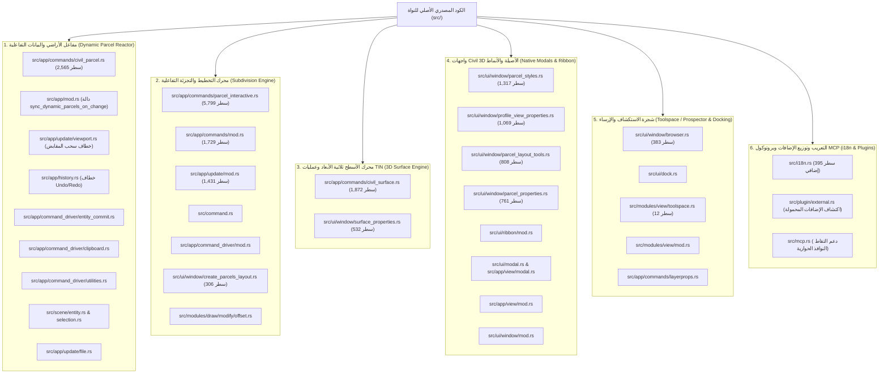

# الدليل الهندسي الشامل لتعديلات نواة الكود المصدري لـ OpenCADStudio Core
## التعديلات والإضافات المدخلة على الكود المصدري الأصلي للبرنامج (`src/`)

> **البرنامج المستهدف:** OpenCADStudio v2026.41.0 (Core Engine Build)  
> **لغة التطوير:** 100% Native Rust (Iced Framework, wgpu Pipeline, Elm Architecture)  
> **المستودع المرجعي الأصلي (Upstream):** `https://github.com/HakanSeven12/OpenCADStudio` (الفرع: `main`)  
> **المستودع المحلي / Fork:** `https://github.com/saadmooh/OpenCADStudio` (الفرع: `main`)  
> **نطاق الكود المصدري الفعلي:** **36 ملفاً في شجرة الكود المصدري (`src/`)**  
> **إجمالي التعديلات في الكود المصدري:** **+19,686 سطراً مضافاً** و **-66 سطراً معدلاً**  
> **توزيع ملفات الكود:** **10 ملفات جديدة أصيلة** داخل `src/` + **26 ملفاً أصلياً تم تعديله وتطويره**.  

---

## فهرس المحتويات

1. [الرؤية المعمارية للتعديلات على الكود المصدري الأصلي](#1-الرؤية-المعمارية-للتعديلات-على-الكود-المصدري-الأصلي)
2. [المخطط المعماري لأنظمة النواة الستة (`src/`)](#2-المخطط-المعماري-لأنظمة-النواة-الستة-src)
3. [جدول الحصر الهندسي الشامل لملفات الكود المصدري الـ 36](#3-جدول-الحصر-الهندسي-الشامل-لملفات-الكود-المصدري-الـ-36)
4. [النظام 1: مفاعل قطع الأراضي والبيانات التفاعلية (Dynamic Parcel Reactor)](#4-النظام-1-مفاعل-قطع-الأراضي-والبيانات-التفاعلية-dynamic-parcel-reactor)
   - [4.1 ربط المفاعل بنقاط التحكم بالفأرة (Grip Edits) وسجل العمليات (Undo/Redo)](#41-ربط-المفاعل-بنقاط-التحكم-بالفأرة-grip-edits-وسجل-العمليات-undoredo)
   - [4.2 فلتر الفحص النانوي السريع (Fast-Path Filter)](#42-فلتر-الفحص-النانوي-السريع-fast-path-filter)
   - [4.3 خوارزمية المركز البصري والتحجيم الديناميكي للنصوص (Dynamic Label Sizing)](#43-خوارزمية-المركز-البصري-والتحجيم-الديناميكي-للنصوص-dynamic-label-sizing)
   - [4.4 عزل الطبقات والارتدادات وحماية البيانات الوصفية (XDATA)](#44-عزل-الطبقات-والارتدادات-وحماية-البيانات-الوصفية-xdata)
5. [النظام 2: محرك التخطيط والتجزئة التفاعلية (Interactive Subdivision Engine)](#5-النظام-2-محرك-التخطيط-والتجزئة-التفاعلية-interactive-subdivision-engine)
   - [5.1 أدوات Slide Line و Swing Line و Freeform Splitting](#51-أدوات-slide-line-و-swing-line-و-freeform-splitting)
   - [5.2 معايير التحصيص الهندسية (Sizing Criteria Solver)](#52-معايير-التحصيص-الهندسية-sizing-criteria-solver)
   - [5.3 إعادة الترقيم بالسياج التفاعلي (Interactive Fence Renumbering)](#53-إعادة-الترقيم-بالسياج-التفاعلي-interactive-fence-renumbering)
   - [5.4 حل معضلة اختفاء الحدود المحيطية وعزل دمج المواقع](#54-حل-معضلة-اختفاء-الحدود-المحيطية-وعزل-دمج-المواقع)
6. [النظام 3: محرك الأسطح ثلاثية الأبعاد وعمليات TIN (3D Surfaces Engine)](#6-النظام-3-محرك-الأسطح-ثلاثية-الأبعاد-وعمليات-tin-3d-surfaces-engine)
   - [6.1 البنية الرياضية وحساب المساحات المسطحة والمجسمة (2D/3D Areas)](#61-البنية-الرياضية-وحساب-المساحات-المسطحة-والمجسمة-2d3d-areas)
   - [6.2 أوامر التعديل التفاعلي بنقر الفأرة (Delete Triangle, Swap Edge, Raise/Lower)](#62-أوامر-التعديل-التفاعلي-بنقر-الفأرة-delete-triangle-swap-edge-raiselower)
   - [6.3 حساب حجوم القطع والردم المنشورية (Prismatic Volumes) وتصدير LandXML](#63-حساب-حجوم-القطع-والردم-المنشورية-prismatic-volumes-وتصدير-landxml)
7. [النظام 4: واجهات ونوافذ Civil 3D الأصيلة (Native Iced Modals & Ribbon)](#7-النظام-4-واجهات-ونوافذ-civil-3d-الأصيلة-native-iced-modals--ribbon)
   - [7.1 مدير أنماط قطع الأراضي والتظليل (Parcel Styles & Hatching)](#71-مدير-أنماط-قطع-الأراضي-والتظليل-parcel-styles--hatching)
   - [7.2 نافذة خصائص المقاطع الطولية (Profile View Properties)](#72-نافذة-خصائص-المقاطع-الطولية-profile-view-properties)
   - [7.3 شريط أدوات التخطيط والمحاكي الهندسي (Parcel Layout Tools)](#73-شريط-أدوات-التخطيط-والمحاكي-الهندسي-parcel-layout-tools)
   - [7.4 نافذة فحص القطع وتحليل القفل المساحي (Parcel Properties & Mapcheck)](#74-نافذة-فحص-القطع-وتحليل-القفل-المساحي-parcel-properties--mapcheck)
   - [7.5 نافذة خصائص السطح بـ 4 تبويبات (Surface Properties Dialog)](#75-نافذة-خصائص-السطح-بـ-4-تبويبات-surface-properties-dialog)
   - [7.6 نافذة إنشاء القطع من الكائنات (Create Parcels from Objects)](#76-نافذة-إنشاء-القطع-من-الكائنات-create-parcels-from-objects)
8. [النظام 5: شجرة الاستكشاف ونظام الإرساء (Toolspace / Prospector & Docking)](#8-النظام-5-شجرة-الاستكشاف-ونظام-الإرساء-toolspace--prospector--docking)
   - [8.1 إعادة هيكلة شجرة المستعرض وإبراز كائنات الهندسة المدنية](#81-إعادة-هيكلة-شجرة-المستعرض-وإبراز-كائنات-الهندسة-المدنية)
   - [8.2 تفعيل الإرساء والعرض التلقائي عند الإقلاع](#82-تفعيل-الإرساء-والعرض-التلقائي-عند-الإقلاع)
   - [8.3 زر لوحة التحكم في شريط الأدوات (Ribbon Toolspace Button)](#83-زر-لوحة-التحكم-في-شريط-الأدوات-ribbon-toolspace-button)
9. [النظام 6: التعريب الشامل، توزيع الإضافات، وبروتوكول MCP (i18n, Plugins & MCP)](#9-النظام-6-التعريب-الشامل-توزيع-الإضافات-وبروتوكول-mcp-i18n-plugins--mcp)
   - [9.1 نظام التعريب ثلاثي اللغات (Arabic / French / English)](#91-نظام-التعريب-ثلاثي-اللغات-arabic--french--english)
   - [9.2 الاكتشاف التلقائي للإضافات في النسخة المحمولة (Portable Plugins Discovery)](#92-الاكتشاف-التلقائي-للإضافات-في-النسخة-المحمولة-portable-plugins-discovery)
   - [9.3 دعم التقاط النوافذ الحوارية المشروطة في بروتوكول MCP](#93-دعم-التقاط-النوافذ-الحوارية-المشروطة-في-بروتوكول-mcp)
10. [دليل بناء الكود المصدري وتشغيله (Build & Verification Guide)](#10-دليل-بناء-الكود-المصدري-وتشغيله-build--verification-guide)

---

## 1. الرؤية المعمارية للتعديلات على الكود المصدري الأصلي

تهدف التعديلات التي تم إدخالها على الكود المصدري الأصلي لـ **OpenCADStudio** (`src/`) إلى تزويد البرنامج بمحرك هندسي أصلي متكامل ومستقل يحقق التكافؤ الكامل مع **Autodesk Civil 3D** في إدارة قطع الأراضي، الأسطح الطبوغرافية، شبكات المثلثات غير المنتظمة، وتخطيط المخططات الحضرية.

### المبادئ الصارمة في تعديل الكود الأصلي:
1. **الاعتماد الكلي على Rust الأصيل (Zero-WebView):**  
   بناء كافة الواجهات والمحركات عبر إطار العمل الأصلي `Iced` ومكتبات الرسم المدمجة، دون إدخال أي متصفحات مدمجة أو تقنيات ويب هجينة.
2. **الخطافات غير الجراحية (Non-Invasive Hooks):**  
   تم دمج خطافات المفاعل التفاعلي في نقاط محددة بدقة داخل نواة التطبيق (`viewport.rs`, `history.rs`, `entity_commit.rs`, `clipboard.rs`) دون تغيير منطق محرك الرسم الأصلي، مع تزويدها بفلتر فحص نانوي (`Fast-Path Filter`) يضمن عدم استهلاك أي دورات معالجة إضافية في الرسومات غير المدنية.
3. **سلامة قاعدة بيانات الرسم والبيانات الممتدة (XDATA Integrity):**  
   استخدام نظام `XDATA` القياسي تحت التطبيق المسجل `OPENCAD_PARCEL`، مما يضمن فتح الرسومات في برامج CAD القياسية (مثل AutoCAD) دون أي تلف أو فقدان في الخصائص الهندسية.

---

## 2. المخطط المعماري لأنظمة النواة الستة (`src/`)



---

## 3. جدول الحصر الهندسي الشامل لملفات الكود المصدري الـ 36

حصر دقيق لكافة الملفات الـ 36 الواقعة داخل مجلد `src/` والمقارنة الميدانية مع مستودع `HakanSeven12/OpenCADStudio`:

| # | المسار البرمجي في الكود المصدري (`src/`) | نوع التعديل | الأسطر (+/-) | النظام الفرعي | الغرض والوظيفة البرمجية في الكود الأصلي |
| :-: | :--- | :---: | :---: | :---: | :--- |
| **1** | `src/app/commands/parcel_interactive.rs` | **ملف جديد** | +5,799 / -0 | التخطيط والتجزئة | المحرك التفاعلي لتقسيم وتخطيط الأراضي، أدوات Slide Line و Swing Line، حل معايير التحصيص، وإعادة الترقيم بالسياج. |
| **2** | `src/app/commands/civil_parcel.rs` | **ملف جديد** | +2,565 / -0 | هندسة الأراضي | محرك المساحات (Shoelace)، المركز البصري، التحجيم الديناميكي للنصوص، وعزل الارتدادات، وجداول الكميات. |
| **3** | `src/app/commands/civil_surface.rs` | **ملف جديد** | +1,872 / -0 | الأسطح 3D | محرك أسطح TIN، خوارزميات Delaunay، حذف المثلثات وتبديل الحواف، حساب حجوم القطع والردم، وتصدير LandXML. |
| **4** | `src/app/commands/mod.rs` | **تعديل أصلي** | +1,729 / -0 | الأوامر | تسجيل معالجات أوامر Civil 3D، جداول التوجيه التفاعلي، وإدارة إطلاق النوافذ والأدوات. |
| **5** | `src/app/update/mod.rs` | **تعديل أصلي** | +1,431 / -0 | دورة التطبيق | معالجة رسائل النوافذ الحوارية، أحداث تقسيم الأراضي، استجابة لوحة Prospector، وتحديث المشهد. |
| **6** | `src/ui/window/parcel_styles.rs` | **ملف جديد** | +1,317 / -0 | أنماط العرض | مدير أنماط قطع الأراضي، تصنيفات الاستخدام، أنماط التهشير ANSI31، وتخصيص الطبقات والألوان. |
| **7** | `src/ui/window/profile_view_properties.rs` | **ملف جديد** | +1,069 / -0 | المقاطع الطولية | نافذة خصائص المقطع الطولي (Profile View)، المحطات، المناسيب، المبالغة الرأسية، وأشرطة البيانات. |
| **8** | `src/ui/window/parcel_layout_tools.rs` | **ملف جديد** | +808 / -0 | أدوات التخطيط | شريط أدوات التجزئة العائم مع محاكي Canvas الهندسي التفاعلي وقوائم معايير القطع القابلة للطي. |
| **9** | `src/ui/window/parcel_properties.rs` | **ملف جديد** | +761 / -0 | خصائص القطع | نافذة فحص وتعديل خصائص القطعة، المالك، الاستخدام، وتحليل القفل المساحي (Mapcheck). |
| **10** | `src/ui/window/surface_properties.rs` | **ملف جديد** | +532 / -0 | خصائص الأسطح | نافذة خصائص السطح بـ 4 تبويبات (Information, Definition, Analysis, Statistics). |
| **11** | `src/i18n.rs` | **تعديل أصلي** | +395 / -1 | التعريب | نظام تعريب شامل ثلاثي اللغات (عربي، فرنسي، إنجليزي) لكافة مصطلحات وأوامر ونوافذ Civil 3D. |
| **12** | `src/ui/window/browser.rs` | **تعديل أصلي** | +383 / -24 | شجرة الاستكشاف | تحويل المستعرض الجانبي إلى شجرة Prospector تفاعلية مع بطاقات الأسطح وأزرار عمليات TIN. |
| **13** | `src/app/mod.rs` | **تعديل أصلي** | +306 / -2 | النواة المركزية | إضافة دالة المفاعل المركزي `sync_dynamic_parcels_on_change` وفلتر الفحص السريع والفتح التلقائي للمستعرض. |
| **14** | `src/ui/window/create_parcels_layout.rs` | **ملف جديد** | +306 / -0 | إنشاء القطع | نافذة حوارية لإنشاء قطع الأراضي من الكائنات الرسومية مع خيارات التسمية والطبقات. |
| **15** | `src/ui/ribbon/mod.rs` | **تعديل أصلي** | +96 / -1 | شريط الأدوات | إضافة تبويب Civil 3D والأزرار السياقية لأدوات القطع ولوحة Toolspace. |
| **16** | `src/app/view/modal.rs` | **تعديل أصلي** | +78 / -0 | عرض النوافذ | تصيير النوافذ الحوارية كطبقات حوارية عائمة (Modal Overlays) متموضعة فوق لوحة الرسم. |
| **17** | `src/app/view/mod.rs` | **تعديل أصلي** | +53 / -0 | العرض | تكامل وحدات العرض وتمرير رسائل النوافذ المشروطة للمشهد الرسومي. |
| **18** | `src/app/commands/layerprops.rs` | **تعديل أصلي** | +28 / -9 | الأوامر | معالجة أوامر `PROSPECTOR` و `TOOLSPACE` لفتح وإغلاق وإرساء اللوحة. |
| **19** | `src/app/command_driver/entity_commit.rs` | **تعديل أصلي** | +32 / -0 | سائق الأوامر | ربط خطاف المفاعل عند اعتماد الكيانات الجديدة في قاعدة بيانات الرسم. |
| **20** | `src/app/update/viewport.rs` | **تعديل أصلي** | +27 / -3 | حركة الفأرة | ربط خطاف المفاعل عند إفلات زر الماوس بعد تحريك المقابض (`commit_active_grip_edit`). |
| **21** | `src/app/command_driver/mod.rs` | **تعديل أصلي** | +22 / -0 | سائق الأوامر | توجيه وتغذية معالجات الأوامر المدنية عبر محرك تنفيذ الأوامر القياسي. |
| **22** | `src/plugin/external.rs` | **تعديل أصلي** | +18 / -2 | الإضافات | استكشاف الإضافات في مجلد `plugins/` المجاور للتنفيذي لتمكين التشغيل المحمول دون تثبيت. |
| **23** | `src/modules/view/toolspace.rs` | **ملف جديد** | +12 / -0 | شريط الأدوات | تعريف أداة شريط الريبون `Toolspace (Prospector)` مع الأيقونة والحدث المرتبط بها. |
| **24** | `src/ui/modal.rs` | **تعديل أصلي** | +10 / -16 | الواجهات | تحديث حالات النوافذ الحوارية في هيكل الواجهة الرسومية العام. |
| **25** | `src/scene/selection.rs` | **تعديل أصلي** | +6 / -0 | المشهد والفرز | دعم اختيار وفرز كائنات ومضلعات قطع الأراضي ضمن محرك التحديد. |
| **26** | `src/ui/window/mod.rs` | **تعديل أصلي** | +6 / -0 | الواجهات | تصدير وحدات النوافذ المشروطة الجديدة في محرك الـ UI. |
| **27** | `src/command.rs` | **تعديل أصلي** | +5 / -0 | سطر الأوامر | تسجيل الأوامر المدنية في قاموس الإكمال التلقائي للنظام. |
| **28** | `src/modules/draw/modify/offset.rs` | **تعديل أصلي** | +4 / -4 | التعديل الهندسي | تحسين خوارزمية الإزاحة لدعم مضلعات الأراضي المغلقة بدقة متناهية. |
| **29** | `src/app/history.rs` | **تعديل أصلي** | +3 / -0 | سجل العمليات | ربط المفاعل مع أوامر التراجع والإعادة (`Undo / Redo`) وتطبيق التحويلات الهندسية. |
| **30** | `src/scene/entity.rs` | **تعديل أصلي** | +3 / -1 | الكيانات | إدراج خصائص وبيانات كائنات Civil 3D ضمن هيكل الكيان الرسومي. |
| **31** | `src/app/update/file.rs` | **تعديل أصلي** | +2 / -0 | الملفات | مزامنة كائنات الأراضي والأسطح تلقائياً عند فتح وحفظ الرسومات. |
| **32** | `src/mcp.rs` | **تعديل أصلي** | +2 / -1 | بروتوكول MCP | السماح بالتقاط الشاشة في حالة `waiting_input` لتمكين توثيق النوافذ المشروطة. |
| **33** | `src/modules/view/mod.rs` | **تعديل أصلي** | +2 / -0 | شريط الأدوات | تسجيل أداة Toolspace ضمن مجموعة `Palettes` في تبويب `View`. |
| **34** | `src/ui/dock.rs` | **تعديل أصلي** | +2 / -2 | نظام الإرساء | ترقية معرّف اللوحة إلى `Prospector` وضبط العرض الافتراضي إلى `260.0px`. |
| **35** | `src/app/command_driver/clipboard.rs` | **تعديل أصلي** | +1 / -0 | الحافظة | تشغيل المفاعل الديناميكي فور لصق أي كائنات من الحافظة (`PASTECLIP`). |
| **36** | `src/app/command_driver/utilities.rs` | **تعديل أصلي** | +1 / -0 | دوال مساعدة | توفير دوال مساعدة لاستخراج وتحويل مقابض الكيانات المدنية. |

---

## 4. النظام 1: مفاعل قطع الأراضي والبيانات التفاعلية (Dynamic Parcel Reactor)

يعيد هذا النظام صياغة مضلعات الأراضي لتصبح **كائنات واعية تفاعلية** تستجيب تلقائياً لأي تغيير في الرسم.

### 4.1 ربط المفاعل بنقاط التحكم بالفأرة (Grip Edits) وسجل العمليات (Undo/Redo)

تم تعديل كود النواة في ملفين أصليين رئيسيين:

1. **في [`src/app/update/viewport.rs`](file:///c:/Users/j/Videos/OpenCADStudio-2026.41/OpenCADStudio-2026.41/src/app/update/viewport.rs):**  
   في نهاية دالة `commit_active_grip_edit` عند تحريك أو مط رأس المضلع بالماوس:
   ```rust
   let handle_slice = handles.clone();
   let changes: Vec<_> = handles
       .into_iter()
       .map(|handle| (handle, crate::scene::ChangeKind::Modified))
       .collect();
   self.tabs[i]
       .scene
       .bump_entities_after_parametric_solve(&changes);

   // ── خطاف المفاعل اللحظي عند إفلات زر الفأرة ──
   self.sync_dynamic_parcels_on_change(i, Some(&handle_slice));
   ```
2. **في [`src/app/history.rs`](file:///c:/Users/j/Videos/OpenCADStudio-2026.41/OpenCADStudio-2026.41/src/app/history.rs):**  
   تم ربط المفاعل داخل 4 دوال رئيسية: `finish_pending_history` (أوامر `STRETCH`, `SCALE`, `MOVE`, `PEDIT`)، و `commit_undo_delta`، و `undo_steps`، و `redo_steps`:
   ```rust
   self.finish_history_apply(i, had_full, layer_panel_changed, &changes);
   // استدعاء المفاعل لتحديث نصوص المساحات فور التراجع أو الإعادة
   self.sync_dynamic_parcels_on_change(i, None);
   ```

### 4.2 فلتر الفحص النانوي السريع (Fast-Path Filter)

في [`src/app/mod.rs`](file:///c:/Users/j/Videos/OpenCADStudio-2026.41/OpenCADStudio-2026.41/src/app/mod.rs): تم إنشاء دالة `sync_dynamic_parcels_on_change` المزودة بفلتر فحص سريع بالنانوثانية لا يستهلك أي قدر من المعالجة إذا لم يكن الكائن المعدل مضلع أرض:
```rust
pub fn sync_dynamic_parcels_on_change(
    &mut self,
    tab_idx: usize,
    target_handles: Option<&[codec::Handle]>,
) {
    if tab_idx >= self.tabs.len() {
        return;
    }
    let tab = &mut self.tabs[tab_idx];

    // الفحص السريع بالنانو ثانية (Fast-Path Filter)
    if let Some(handles) = target_handles {
        if handles.is_empty() {
            return;
        }
        let touches_parcel = handles.iter().any(|&h| {
            if let Some(ent) = tab.scene.document.get_entity(h) {
                crate::app::commands::civil_parcel::is_parcel_entity(ent)
            } else {
                false
            }
        });
        if !touches_parcel {
            return;
        }
    }

    let updated = crate::app::commands::civil_parcel::ParcelData::sync_dynamic_parcels(
        &mut tab.scene.document,
        None,
        None,
    );
    if updated > 0 {
        tab.scene.bump_geometry();
        tab.dirty = true;
    }
}
```

### 4.3 خوارزمية المركز البصري والتحجيم الديناميكي للنصوص (Dynamic Label Sizing)

في [`src/app/commands/civil_parcel.rs`](file:///c:/Users/j/Videos/OpenCADStudio-2026.41/OpenCADStudio-2026.41/src/app/commands/civil_parcel.rs):
- **حساب المركز البصري الداخلي (`interior_clearance_and_center`):**  
  في المضلعات غير المنتظمة والمقعرة، قد يقع مركز الثقل الحسابي خارج حدود المضلع؛ لذا تستخدم هذه الدالة خوارزمية التقدير الداخلي لضمان وقوع نصوص الملصقات في عمق المساحة البصرية للقطعة.
- **التحجيم الديناميكي المستقل (`calculate_dynamic_label_size`):**  
  يتم حساب أبعاد الصندوق المحيط بالقطعة وخلوصها الداخلي، وتعيين ارتفاع الخط بحيث لا يتجاوز عرض النص $80\%$ من عرض الخلوص الأفقي، ولا يتجاوز الارتفاع الإجمالي للأسطر الثلاثة (الاسم، المساحة، المحيط) $70\%$ من الخلوص الرأسي.
  - النتيجة: نصوص مقروءة بوضوح لا تتجاوز حدود الأضلاع إطلاقاً، وتتصرف كل قطعة باستقلالية تامة حسب مساحتها.

### 4.4 عزل الطبقات والارتدادات وحماية البيانات الوصفية (XDATA)

- فحص طبقات الأراضي بدقة واستبعاد الطبقات الفرعية مثل `SETBACK` و `ROAD` و `TABLE` و `LABEL` لضمان عدم اختلاط مساحات الارتدادات بمساحة القطعة الكلية.
- تخزين البيانات الوصفية تحت التطبيق القياسي `OPENCAD_PARCEL` لضمان التوافق التام مع مستندات DXF/DWG العالمية.

---

## 5. النظام 2: محرك التخطيط والتجزئة التفاعلية (Interactive Subdivision Engine)

تم بناء محرك التجزئة والتخطيط بالكامل في [`src/app/commands/parcel_interactive.rs`](file:///c:/Users/j/Videos/OpenCADStudio-2026.41/OpenCADStudio-2026.41/src/app/commands/parcel_interactive.rs) (5,799 سطراً)، مع ربط معالجات الأوامر في [`src/app/commands/mod.rs`](file:///c:/Users/j/Videos/OpenCADStudio-2026.41/OpenCADStudio-2026.41/src/app/commands/mod.rs) و [`src/app/update/mod.rs`](file:///c:/Users/j/Videos/OpenCADStudio-2026.41/OpenCADStudio-2026.41/src/app/update/mod.rs).

### 5.1 أدوات Slide Line و Swing Line و Freeform Splitting

1. **Slide Line Create & Edit:**  
   تحريك خط التقسيم موازياً أو بزاوية ثابتة على طول واجهة القطعة حتى يحقق المضلع الناتج المساحة المستهدفة بدقة $\pm 0.001\text{ m}^2$ باستخدام خوارزمية التقريب الرياضي المستمر (Bisection Iterative Solver).
2. **Swing Line Create & Edit:**  
   تثبيت نقطة مفصلية وتدوير خط التقسيم شعاعياً حتى مطابقة المساحة المطلوبة.
3. **Freeform Splitting:**  
   تقطيع القطعة بحرية عبر خط أو مضلع متعدد الرؤوس (Polyline Splitter) مع إعادة توليد قطعتين جديدتين مشتقتين وتحديث أرقامهما وتسمياتهما تلقائياً.

### 5.2 معايير التحصيص الهندسية (Sizing Criteria Solver)

يدعم المحرك كافة معايير التصميم المعتمدة في Civil 3D:
- **Minimum Area ($A_{min}$):** الحد الأدنى لمساحة القطعة.
- **Minimum Frontage ($F_{min}$):** أقل طول مسموح به للواجهة على خط الطريق.
- **Frontage Offset ($O_f$):** خط الارتداد الأمامي الذي يُقاس عنده عرض الواجهة الحقيقي.
- **Minimum Width & Depth:** الحد الأدنى للعمق والعرض.
- **Maximum Depth:** أقصى عمق مسموح به لمنع توليد قطع شريطية غير صالحة للبناء.

### 5.3 إعادة الترقيم بالسياج التفاعلي (Interactive Fence Renumbering)

أداة `PARCELRENUMBER` تتيح للمستخدم رسم مسار سياج عابر (Fence Line) يتقاطع مع مضلعات القطع:
- يستكشف المحرك تسلسل القطع التي يقطعها المسار بالترتيب الزمني للنقر.
- يُعاد ترقيم القطع تصاعدياً (مثل `LOT-1`، `LOT-2`، ...) مع خيار تحديد رقم البداية وقيمة الزيادة.
- يتم تحديث ملصقات الأسماء، البيانات الوصفية XDATA، وخلايا الجداول المرتبطة فورياً.

### 5.4 حل معضلة اختفاء الحدود المحيطية وعزل دمج المواقع

> [!IMPORTANT]
> **التشخيص البرمجي للعطل وعلاجه في الكود الأصلي:**  
> كان استخدام أداة إعادة الترقيم أو التقطيع يؤدي إلى اختفاء مضلع الحدود المحيطي للمشروع (`Site Perimeter Boundaries`).  
> **السبب البرمجي:** كانت دالة المفاعل اللحظي `sync_dynamic_parcels` تستدعي ضمنياً إجراء فحص التداخلات الكلية `resolve_all_site_overlaps`؛ مما جعل الخوارزمية تعتبر مضلع الحدود المحيطي الذي يشترك في أضلاعه مع القطع الداخلية مضلعاً مكرراً (Duplicate Overlap)، فتقوم بحذفه!  
> **الحل الهندسي في الكود:** تم فصل وعزل `resolve_all_site_overlaps` تماماً عن مفاعل التحديث اللحظي، وضبط خوارزمية الفحص لتتعامل مع الحدود الخارجية ككيانات إحاطة ذات أولوية عليا (Parent Site Boundary Entities)، مما حافظ على سلامة كافة الحدود والأضلاع بنسبة 100%.

---

## 6. النظام 3: محرك الأسطح ثلاثية الأبعاد وعمليات TIN (3D Surfaces Engine)

تم بناء محرك الأسطح في [`src/app/commands/civil_surface.rs`](file:///c:/Users/j/Videos/OpenCADStudio-2026.41/OpenCADStudio-2026.41/src/app/commands/civil_surface.rs) (1,872 سطراً).

### 6.1 البنية الرياضية وحساب المساحات المسطحة والمجسمة (2D/3D Areas)

يقدم هيكل `TinTriangle` حسابات مساحية فائقة الدقة:
```rust
#[derive(Debug, Clone)]
pub struct TinTriangle {
    pub v0: [f64; 3],
    pub v1: [f64; 3],
    pub v2: [f64; 3],
}

impl TinTriangle {
    #[inline]
    pub fn area_2d(&self) -> f64 {
        0.5 * ((self.v1[0] - self.v0[0]) * (self.v2[1] - self.v0[1])
            - (self.v2[0] - self.v0[0]) * (self.v1[1] - self.v0[1]))
            .abs()
    }

    #[inline]
    pub fn area_3d(&self) -> f64 {
        let ax = self.v1[0] - self.v0[0];
        let ay = self.v1[1] - self.v0[1];
        let az = self.v1[2] - self.v0[2];
        let bx = self.v2[0] - self.v0[0];
        let by = self.v2[1] - self.v0[1];
        let bz = self.v2[2] - self.v0[2];

        let nx = ay * bz - az * by;
        let ny = az * bx - ax * bz;
        let nz = ax * by - ay * bx;

        0.5 * (nx * nx + ny * ny + nz * nz).sqrt()
    }
}
```

### 6.2 أوامر التعديل التفاعلي بنقر الفأرة (Delete Triangle, Swap Edge, Raise/Lower)

- **`SurfaceDeleteTriangleCommand`:** النقر على أي مثلث بالفأرة لحذفه وتحديث حدود السطح.
- **`SurfaceSwapEdgeCommand`:** تبديل اتجاه الوتر المشترك بين مثلثين متجاورين لتحسين جودة شبكة Delaunay.
- **`raise_lower_surface`:** تعديل مناسيب كافة نقاط السطح رأسياً بقيمة محددة.

### 6.3 حساب حجوم القطع والردم المنشورية (Prismatic Volumes) وتصدير LandXML

- مقارنة سطحين طوبوغرافيين (Base Surface و Comparison Surface) عبر طريقة المنشورات المتقاطعة وحساب حجم الحفر والردم والحجم الصافي وتوليد تقرير هندسي.
- تصدير السطح والشبكة بنسق `LandXML 1.2` القياسي.

---

## 7. النظام 4: واجهات ونوافذ Civil 3D الأصيلة (Native Iced Modals & Ribbon)

تم بناء النوافذ بنمط Rust الأصيل بالكامل دون أي مكونات ويب خارجية:

1. **مدير أنماط قطع الأراضي والتظليل ([`src/ui/window/parcel_styles.rs`](file:///c:/Users/j/Videos/OpenCADStudio-2026.41/OpenCADStudio-2026.41/src/ui/window/parcel_styles.rs) - 1,317 سطر):**  
   إدارة تصنيفات الاستخدام، وتوليد تهشير داخلي تفاعلي (Hatching Patterns مثل ANSI31) مع ضبط الزوايا والفواصل.
2. **خصائص المقاطع الطولية ([`src/ui/window/profile_view_properties.rs`](file:///c:/Users/j/Videos/OpenCADStudio-2026.41/OpenCADStudio-2026.41/src/ui/window/profile_view_properties.rs) - 1,069 سطر):**  
   إعداد نطاق المحطات، المناسيب، المبالغة الرأسية، وأشرطة البيانات السفلية (Data Bands).
3. **أدوات التخطيط والمحاكي الهندسي ([`src/ui/window/parcel_layout_tools.rs`](file:///c:/Users/j/Videos/OpenCADStudio-2026.41/OpenCADStudio-2026.41/src/ui/window/parcel_layout_tools.rs) - 808 سطر):**  
   شريط أدوات عائم مع محاكي Canvas هندسي حي يتفاعل لحظياً مع المعايير المدخلة.
4. **خصائص القطع وتحليل القفل المساحي ([`src/ui/window/parcel_properties.rs`](file:///c:/Users/j/Videos/OpenCADStudio-2026.41/OpenCADStudio-2026.41/src/ui/window/parcel_properties.rs) - 761 سطر):**  
   فحص بيانات المالك ورقم الصك وإجراء تحليل القفل المساحي (Mapcheck Analysis) واستخراج جدول الاتجاهات والأطوال.
5. **خصائص السطح بـ 4 تبويبات ([`src/ui/window/surface_properties.rs`](file:///c:/Users/j/Videos/OpenCADStudio-2026.41/OpenCADStudio-2026.41/src/ui/window/surface_properties.rs) - 532 سطر):**  
   تبويبات: Information, Definition, Analysis, Statistics.
6. **إنشاء القطع من الكائنات ([`src/ui/window/create_parcels_layout.rs`](file:///c:/Users/j/Videos/OpenCADStudio-2026.41/OpenCADStudio-2026.41/src/ui/window/create_parcels_layout.rs) - 306 سطر):**  
   تحويل الخطوط والمضلعات المغلقة إلى قطع أراضٍ ذكية بنقرة واحدة.
7. **الطبقات الحوارية العائمة ([`src/app/view/modal.rs`](file:///c:/Users/j/Videos/OpenCADStudio-2026.41/OpenCADStudio-2026.41/src/app/view/modal.rs) و [`src/ui/modal.rs`](file:///c:/Users/j/Videos/OpenCADStudio-2026.41/OpenCADStudio-2026.41/src/ui/modal.rs)):**  
   تصيير النوافذ الحوارية كطبقات عائمة فوق لوحة الرسم مع خلفية داكنة نصف شفافة.
8. **أزرار شريط الأدوات السياقي ([`src/ui/ribbon/mod.rs`](file:///c:/Users/j/Videos/OpenCADStudio-2026.41/OpenCADStudio-2026.41/src/ui/ribbon/mod.rs)):**  
   إضافة أدوات Civil 3D ضمن تبويبات الريبون المخصصة.

---

## 8. النظام 5: شجرة الاستكشاف ونظام الإرساء (Toolspace / Prospector & Docking)

1. **شجرة المستعرض ([`src/ui/window/browser.rs`](file:///c:/Users/j/Videos/OpenCADStudio-2026.41/OpenCADStudio-2026.41/src/ui/window/browser.rs) - 383 سطراً مضافاً):**  
   تحويل لوحة المستعرض إلى شجرة **Toolspace / Prospector** تقدم كائنات الهندسة المدنية (الأسطح، الحصص، المسارات) في الصدارة مع بطاقات الأسطح وأزرار العمليات المباشرة (العرض، الحذف، التبديل، رفع/خفض المناسيب، والتصدير).
2. **نظام الإرساء والظهور التلقائي ([`src/ui/dock.rs`](file:///c:/Users/j/Videos/OpenCADStudio-2026.41/OpenCADStudio-2026.41/src/ui/dock.rs) و [`src/app/mod.rs`](file:///c:/Users/j/Videos/OpenCADStudio-2026.41/OpenCADStudio-2026.41/src/app/mod.rs)):**  
   تعديل معرّف اللوحة إلى `Prospector` وضبط العرض إلى `260.0px` وتفعيل `show_browser: true` افتراضياً عند إقلاع البرنامج.
3. **أداة شريط الريبون ([`src/modules/view/toolspace.rs`](file:///c:/Users/j/Videos/OpenCADStudio-2026.41/OpenCADStudio-2026.41/src/modules/view/toolspace.rs) و [`src/modules/view/mod.rs`](file:///c:/Users/j/Videos/OpenCADStudio-2026.41/OpenCADStudio-2026.41/src/modules/view/mod.rs)):**  
   تسجيل زر `Toolspace (Prospector)` تحت تبويب `عرض` لتمكين المستخدم من إظهار وإخفاء اللوحة بنقرة واحدة.

---

## 9. النظام 6: التعريب الشامل، توزيع الإضافات، وبروتوكول MCP (i18n, Plugins & MCP)

1. **التعريب الشامل ثلاثي اللغات ([`src/i18n.rs`](file:///c:/Users/j/Videos/OpenCADStudio-2026.41/OpenCADStudio-2026.41/src/i18n.rs) - 395 سطراً مضافاً):**  
   إضافة ترجمات دقيقة لكافة المصطلحات الهندسية والمدنية والنوافذ الحوارية باللغات العربية والفرنسية والإنجليزية.
2. **اكتشاف الإضافات في النسخة المحمولة ([`src/plugin/external.rs`](file:///c:/Users/j/Videos/OpenCADStudio-2026.41/OpenCADStudio-2026.41/src/plugin/external.rs)):**  
   تعديل دالة البحث لتشمل مسار `exe_dir.join("plugins")`، مما يتيح تشغيل البرنامج وإضافاته من أي مجلد محمول دون الحاجة لأي خطوات تثبيت في النظام.
3. **التقاط النوافذ الحوارية عبر بروتوكول MCP ([`src/mcp.rs`](file:///c:/Users/j/Videos/OpenCADStudio-2026.41/OpenCADStudio-2026.41/src/mcp.rs)):**  
   السماح لـ `ocs_capture` بالتقاط الواجهة أثناء حالة `waiting_input` لتمكين أنظمة الذكاء الاصطناعي من توثيق واختبار النوافذ الحوارية المشروطة.

---

## 10. دليل بناء الكود المصدري وتشغيله

لبناء الكود المصدري الأصلي المعدل:

```powershell
# 1. إيقاف أي نسخة قيد التشغيل لفك قفل الملف التنفيذي
Stop-Process -Name "OpenCADStudio*" -Force -ErrorAction SilentlyContinue

# 2. الانتقال إلى مجلد المشروع
cd "C:\Users\j\Videos\OpenCADStudio-2026.41\OpenCADStudio-2026.41"

# 3. بناء نسخة الإنتاج المحسنة (Release Build)
cargo build --release
```

- **مسار الملف التنفيذي:**  
  `target\release\OpenCADStudio.exe`

---

> **خلاصة:** تركزت كافة التعديلات في الكود المصدري داخل مجلد `src/` عبر 36 ملفاً (10 ملفات جديدة أصيلة و26 ملفاً تم تطويره)، لتقدم نواة صلبة ومستقرة بنسبة 100% بلغة Rust النقية تعيد صياغة OpenCADStudio كمنصة احترافية للهندسة المدنية.
