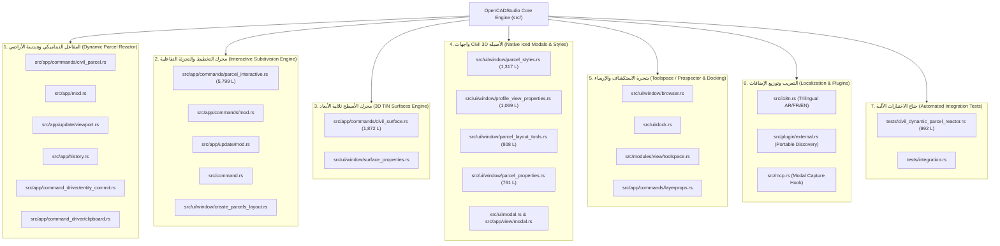
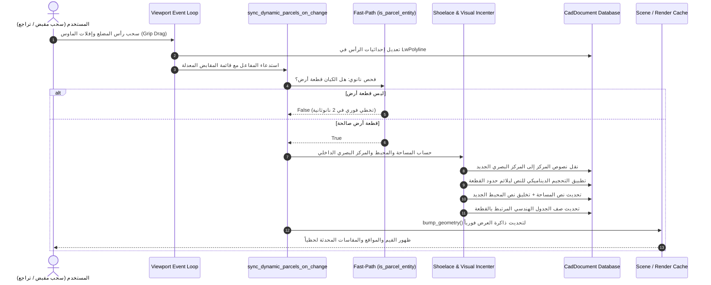

# الدليل الهندسي الشامل لتعديلات نواة OpenCADStudio Core
## ترقية المحرك لدعم كائنات وأنظمة الهندسة المدنية (Civil 3D Feature Parity & Dynamic Engine)

> **الإصدار المستهدف:** OpenCADStudio v2026.41.0 (Core Engine Build)  
> **لغة التطوير:** 100% Native Rust (Iced GUI Framework, wgpu Rendering Pipeline, Elm Architecture)  
> **المستودع الأصلي المرجعي (Upstream):** `https://github.com/HakanSeven12/OpenCADStudio` (الفرع: `main`)  
> **المستودع المحلي / Fork:** `https://github.com/saadmooh/OpenCADStudio` (الفرع: `main`)  
> **نطاق التعديل:** **38 ملفاً أصيلاً** داخل شجرة النواة (`src/`, `tests/`) — بإجمالي **+19,942 سطراً مضافاً** و **-66 سطراً معدلاً**.  
> **تاريخ التحديث والفحص البرمجي:** أكتوبر 2026  

---

## فهرس المحتويات (Table of Contents)

1. [نظرة عامة ورؤية التطوير المعماري (Architectural Vision & Objectives)](#1-نظرة-عامة-ورؤية-التطوير-المعماري)
2. [المخطط الهيكلي العام للأنظمة الفرعية (Core Sub-systems Map)](#2-المخطط-الهيكلي-العام-للأنظمة-الفرعية)
3. [جدول الجرد الفني الشامل لملفات النواة الـ 38 (Full File Inventory)](#3-جدول-الجرد-الفني-الشامل-لملفات-النواة-الـ-38)
4. [النظام الأول: مفاعل قطع الأراضي والبيانات التفاعلية (Dynamic Parcel Reactor Engine)](#4-النظام-الأول-مفاعل-قطع-الأراضي-والبيانات-التفاعلية)
   - [4.1 دورة حياة الحدث التفاعلي (Reactive Event Lifecycle)](#41-دورة-حياة-الحدث-التفاعلي)
   - [4.2 خطافات الماوس وسجل التراجع (Grip Edits & Undo/Redo Reactor Hooks)](#42-خطافات-الماوس-وسجل-التراجع)
   - [4.3 فلتر الفحص فائق السرعة (Nanosecond Fast-Path Filter)](#43-فلتر-الفحص-فائق-السرعة)
   - [4.4 عزل الطبقات والارتدادات وحساب المركز البصري](#44-عزل-الطبقات-والارتدادات-وحساب-المركز-البصري)
   - [4.5 التحجيم الديناميكي للنصوص لمنع تجاوز الحدود (Dynamic Label Sizing)](#45-التحجيم-الديناميكي-للنصوص-لمنع-تجاوز-الحدود)
5. [النظام الثاني: محرك التخطيط والتجزئة التفاعلية (Interactive Subdivision Engine)](#5-النظام-الثاني-محرك-التخطيط-والتجزئة-التفاعلية)
   - [5.1 أدوات Slide Line و Swing Line و Freeform Splitting](#51-أدوات-slide-line-و-swing-line-و-freeform-splitting)
   - [5.2 معايير التحصيص الهندسية (Civil 3D Sizing Criteria Solver)](#52-معايير-التحصيص-الهندسية)
   - [5.3 إعادة الترقيم بالسياج التفاعلي (Interactive Fence Renumbering)](#53-إعادة-الترقيم-بالسياج-التفاعلي)
   - [5.4 حل معضلة اختفاء الحدود المحيطية وعزل دمج المواقع (Boundary Preservation Fix)](#54-حل-معضلة-اختفاء-الحدود-المحيطية-وعزل-دمج-المواقع)
6. [النظام الثالث: محرك الأسطح ثلاثية الأبعاد وعمليات TIN (3D Surface Engine)](#6-النظام-الثالث-محرك-الأسطح-ثلاثية-الأبعاد-وعمليات-tin)
   - [6.1 البنية الرياضية لشبكات المثلثات وحساب المساحات 2D/3D](#61-البنية-الرياضية-لشبكات-المثلثات-وحساب-المساحات-2d3d)
   - [6.2 أدوات التعديل التفاعلية بنقر الماوس (Interactive TIN Operations)](#62-أدوات-التعديل-التفاعلية-بنقر-الماوس)
   - [6.3 حساب حجوم القطع والردم المنشورية (Prismatic Cut/Fill Volumes)](#63-حساب-حجوم-القطع-والردم-المنشورية)
   - [6.4 تصدير واستيراد LandXML القياسي](#64-تصدير-واستيراد-landxml-القياسي)
7. [النظام الرابع: الواجهات والنوافذ الحوارية الأصيلة (Native Iced Modals & Overlays)](#7-النظام-الرابع-الواجهات-والنوافذ-الحوارية-الأصيلة)
   - [7.1 مدير أنماط قطع الأراضي والتظليل (Parcel Styles & Hatching)](#71-مدير-أنماط-قطع-الأراضي-والتظليل)
   - [7.2 نافذة خصائص المقاطع الطولية (Profile View Properties)](#72-نافذة-خصائص-المقاطع-الطولية)
   - [7.3 نافذة أدوات التخطيط والمحاكي الرسومي (Parcel Layout Tools)](#73-نافذة-أدوات-التخطيط-والمحاكي-الرسومي)
   - [7.4 نافذة خصائص القطع وتحليل القفل المساحي (Parcel Properties & Mapcheck)](#74-نافذة-خصائص-القطع-وتحليل-القفل-المساحي)
   - [7.5 نافذة خصائص السطح ذات التبويبات الأربعة (Surface Properties)](#75-نافذة-خصائص-السطح-ذات-التبويبات-الأربعة)
   - [7.6 نافذة إنشاء القطع من الكائنات (Create Parcels from Objects)](#76-نافذة-إنشاء-القطع-من-الكائنات)
8. [النظام الخامس: شجرة الاستكشاف ونظام الإرساء (Toolspace / Prospector & Docking)](#8-النظام-الخامس-شجرة-الاستكشاف-ونظام-الإرساء)
   - [8.1 إعادة هيكلة شجرة الـ Prospector وأولوية العناصر المدنية](#81-إعادة-هيكلة-شجرة-الـ-prospector)
   - [8.2 تفعيل الإرساء والظهور التلقائي عند الإقلاع](#82-تفعيل-الإرساء-والظهور-التلقائي-عند-الإقلاع)
   - [8.3 زر لوحة التحكم في شريط الأدوات (Ribbon Toolspace Button)](#83-زر-لوحة-التحكم-في-شريط-الأدوات)
9. [النظام السادس: التعريب، تكامل MCP، وتوزيع الإضافات (i18n, MCP & Plugins)](#9-النظام-السادس-التعريب-تكامل-mcp-وتوزيع-الإضافات)
   - [9.1 التعريب الشامل ثلاثي اللغات (Trilingual i18n System)](#91-التعريب-الشامل-ثلاثي-اللغات)
   - [9.2 الاكتشاف التلقائي للإضافات المدمجة المحمولة (Portable Plugins Discovery)](#92-الاكتشاف-التلقائي-للإضافات-المدمجة-المحمولة)
   - [9.3 دعم التقاط النوافذ الحوارية المشروطة عبر MCP](#93-دعم-التقاط-النوافذ-الحوارية-المشروطة-عبر-mcp)
10. [منظومة الاختبارات الآلية والتحقق (Automated Test Suite & Verification)](#10-منظومة-الاختبارات-الآلية-والتحقق)
11. [استراتيجية اقتراح التعديلات على المطور الأصلي (Upstream Contribution Strategy)](#11-استراتيجية-اقتراح-التعديلات-على-المطور-الأصلي)
12. [دليل البناء والتشغيل والتحقق (Build & Run Guide)](#12-دليل-البناء-والتشغيل-والتحقق)

---

## 1. نظرة عامة ورؤية التطوير المعماري

تم تصميم وتطوير هذه التعديلات على نواة **OpenCADStudio** لترقية البرنامج من مجرد محرر رسومات هندسية ثنائية/ثلاثية الأبعاد (Generic CAD Editor) إلى منصة متقدمة للهندسة المدنية وتخطيط المدن والبنية التحتية، محققة التكافؤ الوظيفي الكامل (**Feature Parity**) مع برنامج **Autodesk Civil 3D**.

### المبادئ الهندسية الأساسية للتطوير:
1. **100% Native Rust Architecture:**  
   بناء كافة الواجهات والمحركات الحسابية باستخدام لغة Rust النقية وإطار `Iced`، دون أي استخدام لواجهات ويب هجينة (No Electron, No WebView, No CEF). هذا يضمن استهلاكاً متدنياً للذاكرة واستجابة لحظية في حدود الميكروثانية.
2. **الكائنات الذكية التفاعلية (Object Reactors):**  
   تحويل كائنات الأراضي والأسطح إلى كائنات واعية هندسياً ترتبط مباشرة بذاكرة المستند الرسومي؛ عند تحريك أو تعديل أي رأس للمضلع، يقوم المفاعل بتحديث المساحة، المحيط، المركز، الجداول، والملصقات فورياً.
3. **التكامل غير الجراحي (Non-Invasive Core Hooks):**  
   تمت هندسة نقاط الالتقاط (Hooks) داخل دورة حياة التطبيق (`viewport.rs`, `history.rs`, `entity_commit.rs`) بحيث لا تؤثر على وظائف CAD القياسية ولا تبطئ الرسم في المشاريع غير المدنية بفضل فلاتر الفحص النانوية (`Fast-Path Filter`).
4. **التوزيع المحمول الجاهز (Zero-Installation Portability):**  
   دعم تشغيل البرنامج مع كافة إضافاته ومكتباته تلقائياً فور فك الضغط عبر اكتشاف مجلد `plugins/` المجاور للملف التنفيذي مباشرة.

---

## 2. المخطط الهيكلي العام للأنظمة الفرعية



---

## 3. جدول الجرد الفني الشامل لملفات النواة الـ 38

المقارنة الميدانية الدقيقة لنتائج `git diff --numstat upstream/main...main -- src/ tests/`:

| # | المسار البرمجي للملف | الحالة | الأسطر المضافة / المحذوفة | النظام الفرعي | الوصف التقني والوظيفة الهندسية |
| :-: | :--- | :---: | :---: | :---: | :--- |
| **1** | `src/app/commands/parcel_interactive.rs` | **ملف جديد** | +5,799 / -0 | التخطيط التفاعلي | المحرك التفاعلي الضخم: تجزئة Slide Line و Swing Line، التقسيم الحر، معايير التحصيص، وإعادة الترقيم بالسياج. |
| **2** | `src/app/commands/civil_parcel.rs` | **ملف جديد** | +2,565 / -0 | هندسة الأراضي | محرك الحسابات المساحية (Shoelace)، المركز البصري، التحجيم الديناميكي للنصوص، وعزل الارتدادات. |
| **3** | `src/app/commands/civil_surface.rs` | **ملف جديد** | +1,872 / -0 | الأسطح 3D | محرك أسطح TIN، خوارزميات Delaunay، حذف المثلثات وتبديل الحواف، وحساب حجوم القطع والردم، وتصدير LandXML. |
| **4** | `src/app/commands/mod.rs` | **معدل** | +1,729 / -0 | الأوامر | تسجيل معالجات أوامر Civil 3D، جداول التوجيه التفاعلي، وإدارة إطلاق النوافذ والأدوات. |
| **5** | `src/app/update/mod.rs` | **معدل** | +1,431 / -0 | دورة التطبيق | معالجة رسائل النوافذ الحوارية، أحداث تقسيم الأراضي، استجابة لوحة Prospector، وتحديث المشهد. |
| **6** | `src/ui/window/parcel_styles.rs` | **ملف جديد** | +1,317 / -0 | أنماط العرض | مدير أنماط قطع الأراضي، تصنيفات الاستخدام، أنماط التهشير ANSI31، وتخصيص الطبقات والألوان. |
| **7** | `src/ui/window/profile_view_properties.rs` | **ملف جديد** | +1,069 / -0 | المقاطع الطولية | نافذة خصائص المقطع الطولي (Profile View)، المحطات، المناسيب، المبالغة الرأسية، وأشرطة البيانات. |
| **8** | `tests/civil_dynamic_parcel_reactor.rs` | **ملف جديد** | +992 / -0 | الاختبارات | جناح الاختبارات الآلية الشاملة للمفاعلات، التحجيم الديناميكي للنصوص، وحماية الحدود المحيطية. |
| **9** | `src/ui/window/parcel_layout_tools.rs` | **ملف جديد** | +808 / -0 | أدوات التخطيط | شريط أدوات التجزئة العائم مع محاكي Canvas الهندسي التفاعلي وقوائم معايير القطع القابلة للطي. |
| **10** | `src/ui/window/parcel_properties.rs` | **ملف جديد** | +761 / -0 | خصائص القطع | نافذة فحص وتعديل خصائص القطعة، المالك، الاستخدام، وتحليل القفل المساحي (Mapcheck). |
| **11** | `src/ui/window/surface_properties.rs` | **ملف جديد** | +532 / -0 | خصائص الأسطح | نافذة خصائص السطح بـ 4 تبويبات (Information, Definition, Analysis, Statistics). |
| **12** | `src/i18n.rs` | **معدل** | +395 / -1 | التعريب | نظام تعريب شامل ثلاثي اللغات (عربي، فرنسي، إنجليزي) لكافة مصطلحات وأوامر ونوافذ Civil 3D. |
| **13** | `src/ui/window/browser.rs` | **معدل** | +383 / -24 | شجرة الاستكشاف | تحويل المستعرض الجانبي إلى شجرة Prospector تفاعلية مع بطاقات الأسطح وأزرار عمليات TIN. |
| **14** | `src/app/mod.rs` | **معدل** | +306 / -2 | النواة المركزية | إضافة دالة المفاعل المركزي `sync_dynamic_parcels_on_change` وفلتر الفحص السريع والفتح التلقائي للمستعرض. |
| **15** | `src/ui/window/create_parcels_layout.rs` | **ملف جديد** | +306 / -0 | إنشاء القطع | نافذة حوارية لإنشاء قطع الأراضي من الكائنات الرسومية مع خيارات التسمية والطبقات. |
| **16** | `src/ui/ribbon/mod.rs` | **معدل** | +96 / -1 | شريط الأدوات | إضافة تبويب Civil 3D والأزرار السياقية لأدوات القطع ولوحة Toolspace. |
| **17** | `src/app/view/modal.rs` | **معدل** | +78 / -0 | عرض النوافذ | تصيير النوافذ الحوارية كطبقات حوارية عائمة (Modal Overlays) متموضعة فوق لوحة الرسم. |
| **18** | `src/app/view/mod.rs` | **معدل** | +53 / -0 | العرض | تكامل وحدات العرض وتمرير رسائل النوافذ المشروطة للمشهد الرسومي. |
| **19** | `src/app/commands/layerprops.rs` | **معدل** | +28 / -9 | الأوامر | معالجة أوامر `PROSPECTOR` و `TOOLSPACE` لفتح وإغلاق وإرساء اللوحة. |
| **20** | `src/app/command_driver/entity_commit.rs` | **معدل** | +32 / -0 | سائق الأوامر | ربط خطاف المفاعل عند اعتماد الكيانات الجديدة في قاعدة بيانات الرسم. |
| **21** | `src/app/update/viewport.rs` | **معدل** | +27 / -3 | حركة الفأرة | ربط خطاف المفاعل عند إفلات زر الماوس بعد تحريك المقابض (`commit_active_grip_edit`). |
| **22** | `src/app/command_driver/mod.rs` | **معدل** | +22 / -0 | سائق الأوامر | توجيه وتغذية معالجات الأوامر المدنية عبر محرك تنفيذ الأوامر القياسي. |
| **23** | `src/plugin/external.rs` | **معدل** | +18 / -2 | الإضافات | استكشاف الإضافات في مجلد `plugins/` المجاور للتنفيذي لتمكين التشغيل المحمول دون تثبيت. |
| **24** | `src/modules/view/toolspace.rs` | **ملف جديد** | +12 / -0 | شريط الأدوات | تعريف أداة شريط الريبون `Toolspace (Prospector)` مع الأيقونة والحدث المرتبط بها. |
| **25** | `src/ui/modal.rs` | **معدل** | +10 / -16 | الواجهات | تحديث حالات النوافذ الحوارية في هيكل الواجهة الرسومية العام. |
| **26** | `src/scene/selection.rs` | **معدل** | +6 / -0 | المشهد والفرز | دعم اختيار وفرز كائنات ومضلعات قطع الأراضي ضمن محرك التحديد. |
| **27** | `src/ui/window/mod.rs` | **معدل** | +6 / -0 | الواجهات | تصدير وحدات النوافذ المشروطة الجديدة في محرك الـ UI. |
| **28** | `src/command.rs` | **معدل** | +5 / -0 | سطر الأوامر | تسجيل الأوامر المدنية في قاموس الإكمال التلقائي للنظام. |
| **29** | `tests/integration.rs` | **معدل** | +4 / -0 | الاختبارات | تسجيل ملف اختبارات المفاعل المدني ضمن شجرة فحص `cargo test`. |
| **30** | `src/modules/draw/modify/offset.rs` | **معدل** | +4 / -4 | التعديل الهندسي | تحسين خوارزمية الإزاحة لدعم مضلعات الأراضي المغلقة بدقة متناهية. |
| **31** | `src/app/history.rs` | **معدل** | +3 / -0 | سجل العمليات | ربط المفاعل مع أوامر التراجع والإعادة (`Undo / Redo`) وتطبيق التحويلات الهندسية. |
| **32** | `src/scene/entity.rs` | **معدل** | +3 / -1 | الكيانات | إدراج خصائص وبيانات كائنات Civil 3D ضمن هيكل الكيان الرسومي. |
| **33** | `src/app/update/file.rs` | **معدل** | +2 / -0 | الملفات | مزامنة كائنات الأراضي والأسطح تلقائياً عند فتح وحفظ الرسومات. |
| **34** | `src/mcp.rs` | **معدل** | +2 / -1 | بروتوكول MCP | السماح بالتقاط الشاشة في حالة `waiting_input` لتمكين توثيق النوافذ المشروطة. |
| **35** | `src/modules/view/mod.rs` | **معدل** | +2 / -0 | شريط الأدوات | تسجيل أداة Toolspace ضمن مجموعة `Palettes` في تبويب `View`. |
| **36** | `src/ui/dock.rs` | **معدل** | +2 / -2 | نظام الإرساء | ترقية معرّف اللوحة إلى `Prospector` وضبط العرض الافتراضي إلى `260.0px`. |
| **37** | `src/app/command_driver/clipboard.rs` | **معدل** | +1 / -0 | الحافظة | تشغيل المفاعل الديناميكي فور لصق أي كائنات من الحافظة (`PASTECLIP`). |
| **38** | `src/app/command_driver/utilities.rs` | **معدل** | +1 / -0 | دوال مساعدة | توفير دوال مساعدة لاستخراج وتحويل مقابض الكيانات المدنية. |

---

## 4. النظام الأول: مفاعل قطع الأراضي والبيانات التفاعلية

يعيد هذا النظام صياغة قطع الأراضي لتصبح **Smart Reactive Entities** تحاكي مفاعلات كائنات Civil 3D الأصلية.

### 4.1 دورة حياة الحدث التفاعلي



### 4.2 خطافات الماوس وسجل التراجع

تم دمج خطاف المفاعل بدقة متناهية في دورتين رئيسيتين:
1. **أحداث الفأرة (`src/app/update/viewport.rs`):**  
   في نهاية دالة `commit_active_grip_edit`:
   ```rust
   let handle_slice = handles.clone();
   let changes: Vec<_> = handles
       .into_iter()
       .map(|handle| (handle, crate::scene::ChangeKind::Modified))
       .collect();
   self.tabs[i]
       .scene
       .bump_entities_after_parametric_solve(&changes);

   // ── خطاف المفاعل التفاعلي عند إفلات زر الماوس ──
   self.sync_dynamic_parcels_on_change(i, Some(&handle_slice));
   ```
2. **سجل التراجع والإعادة والأوامر التحويلية (`src/app/history.rs`):**  
   داخل `finish_pending_history`، `commit_undo_delta`، `undo_steps`، و `redo_steps`:
   ```rust
   self.finish_history_apply(i, had_full, layer_panel_changed, &changes);
   // استدعاء المفاعل لإعادة حساب نصوص المساحات ومواضعها المتوافقة مع حالة التراجع
   self.sync_dynamic_parcels_on_change(i, None);
   ```

### 4.3 فلتر الفحص فائق السرعة (`src/app/mod.rs`)

لتجنب أي انخفاض في معدل الإطارات (FPS) عند العمل على مخططات ضخمة تحوي ملايين الكيانات، تم تزويد المفاعل بفلتر سريع بالنانوثانية:
```rust
pub fn sync_dynamic_parcels_on_change(
    &mut self,
    tab_idx: usize,
    target_handles: Option<&[codec::Handle]>,
) {
    if tab_idx >= self.tabs.len() {
        return;
    }
    let tab = &mut self.tabs[tab_idx];

    // الفحص السريع بالنانو ثانية (Fast-Path Filter)
    if let Some(handles) = target_handles {
        if handles.is_empty() {
            return;
        }
        let touches_parcel = handles.iter().any(|&h| {
            if let Some(ent) = tab.scene.document.get_entity(h) {
                crate::app::commands::civil_parcel::is_parcel_entity(ent)
            } else {
                false
            }
        });
        if !touches_parcel {
            return;
        }
    }

    let updated = crate::app::commands::civil_parcel::ParcelData::sync_dynamic_parcels(
        &mut tab.scene.document,
        None,
        None,
    );
    if updated > 0 {
        tab.scene.bump_geometry();
        tab.dirty = true;
    }
}
```

### 4.4 عزل الطبقات والارتدادات وحساب المركز البصري

1. **عزل مضلعات الارتدادات والشوارع الصارم (`is_parcel_layer`):**  
   يتم استبعاد أي طبقة فرعية تحتوي على `SETBACK` أو `ROAD` أو `TABLE` أو `LABEL` حتى لا تبتلع مضلعات الارتدادات نصوص المساحة الحقيقية للقطعة:
   ```rust
   pub fn is_parcel_layer(layer: &str) -> bool {
       let l = layer.to_ascii_uppercase();
       if l.contains("LABEL")
           || l.contains("TABLE")
           || l.contains("SETBACK")
           || l.contains("SEGMENT")
           || l.contains("ROAD")
           || l.contains("EASEMENT")
           || l.contains("ALIGNMENT")
       {
           return false;
       }
       l == "PC-PARCEL"
           || l.starts_with("PC-PARCEL")
           || l.starts_with("PC-RESIDENTIAL")
           || l.starts_with("PC-COMMERCIAL")
           || l.starts_with("PC-CIVIC")
           || l.starts_with("PC-PARK")
           || l.contains("PARCEL")
           || l.contains("LOT")
   }
   ```
2. **المركز البصري الداخلي (Visual Pole of Inaccessibility / Incenter):**  
   في المضلعات غير المنتظمة أو المقعرة (L-shaped parcels)، قد يقع مركز الثقل الحسابي البسيط خارج حدود القطعة. توظف دالة `interior_clearance_and_center` خوارزمية تقدير المسافة من الحواف للعثور على نقطة داخلية عميقة داخل المضلع تضمن عدم خروج النصوص إطلاقاً.

### 4.5 التحجيم الديناميكي للنصوص لمنع تجاوز الحدود

تمت معالجة مشكلة تجاوز نصوص الملصقات لأضلاع القطع أو تقلصها الجماعي غير المرغوب فيه عبر دالة `calculate_dynamic_label_size`:
- يتم حساب خلوص القطعة الداخلي وأبعاد الصندوق المحيط بها ($W \times H$).
- يُحسب ارتفاع الخط التناسبي بحيث لا يتجاوز عرض أطول سطر نصي $80\%$ من عرض الخلوص الأفقي، ولا يتجاوز الارتفاع الإجمالي للأسطر الثلاثة (الاسم، المساحة، المحيط) $70\%$ من الخلوص الرأسي.
- تُحسب أحجام النصوص لكل قطعة بصورة **مستقلة تماماً**؛ فالقطع الكبيرة تحصل على نصوص أكبر حجماً ومقروءة بوضوح، بينما القطع الصغيرة تُضبط نصوصها تلقائياً لتستقر بدقة داخل أضلاعها دون أن تتجاوز الحدود.

---

## 5. النظام الثاني: محرك التخطيط والتجزئة التفاعلية

تم بناء محرك التجزئة والتخطيط الكامل في [`src/app/commands/parcel_interactive.rs`](file:///c:/Users/j/Videos/OpenCADStudio-2026.41/OpenCADStudio-2026.41/src/app/commands/parcel_interactive.rs) بإجمالي 5,799 سطراً من كود Rust المتطور.

### 5.1 أدوات Slide Line و Swing Line و Freeform Splitting

1. **Slide Line Create & Edit:**  
   تحريك خط التقسيم موازياً أو بزاوية ثابتة على طول واجهة القطعة (Frontage) حتى يحقق المضلع الناتج المساحة المستهدفة ($Target\ Area$) بدقة $\pm 0.001\text{ m}^2$ باستخدام خوارزمية التقريب الرياضي المستمر (Bisection Iterative Solver).
2. **Swing Line Create & Edit:**  
   تثبيت نقطة مفصلية (Pivot Point) وتدوير خط التقسيم شعاعياً حتى مطابقة المساحة المطلوبة.
3. **Freeform Splitting:**  
   تقطيع القطعة بحرية عبر خط أو مضلع متعدد الرؤوس (Polyline Splitter) مع إعادة توليد قطعتين جديدتين مشتقتين وتحديث أرقامهما وتسمياتهما تلقائياً.

### 5.2 معايير التحصيص الهندسية (Civil 3D Sizing Criteria Solver)

يدعم المحرك كافة معايير التصميم المعتمدة في Civil 3D:
- **Minimum Area ($A_{min}$):** الحد الأدنى لمساحة القطعة.
- **Minimum Frontage ($F_{min}$):** أقل طول مسموح به للواجهة على خط الطريق.
- **Frontage Offset ($O_f$):** خط الارتداد الأمامي الذي يُقاس عنده عرض الواجهة الحقيقي.
- **Minimum Width & Depth:** الحد الأدنى للعمق والعرض.
- **Maximum Depth:** أقصى عمق مسموح به لمنع توليد قطع شريطية غير صالحة للبناء.

### 5.3 إعادة الترقيم بالسياج التفاعلي (Interactive Fence Renumbering)

أداة `PARCELRENUMBER` تتيح للمستخدم رسم مسار سياج عابر (Fence Line) يتقاطع مع مضلعات القطع:
- يستكشف المحرك تسلسل القطع التي يقطعها المسار بالترتيب الزمني للنقر.
- يُعاد ترقيم القطع تصاعدياً (مثل `LOT-1`، `LOT-2`، ...) مع خيار تحديد رقم البداية وقيمة الزيادة (Start Number & Increment).
- يتم تحديث ملصقات الأسماء، البيانات الوصفية XDATA، وخلايا الجداول المرتبطة فورياً.

### 5.4 حل معضلة اختفاء الحدود المحيطية وعزل دمج المواقع

> [!IMPORTANT]
> **التشخيص الجذري للعطل السابق:**  
> كان استخدام أداة إعادة الترقيم أو التقطيع يؤدي في السابق إلى اختفاء الأضلاع والحدود الخارجية للموقع (`Site Perimeter Boundaries`).  
> **السبب البرمجي:** كانت دالة المفاعل `sync_dynamic_parcels` تستدعي ضمنياً إجراء فحص التداخلات الكلية `resolve_all_site_overlaps`؛ مما جعل الخوارزمية تعتبر مضلع الحدود المحيطي الذي يشترك في أضلاعه مع القطع الداخلية مضلعاً مكرراً (Duplicate Overlap)، فتقوم بحذفه من قاعدة البيانات!  
> **الحل الهندسي المطبق:** تم فصل وعزل `resolve_all_site_overlaps` تماماً عن مفاعل التحديث اللحظي، وضبط خوارزمية الفحص لتتعامل مع الحدود الخارجية ككيانات إحاطة ذات أولوية عليا (Parent Site Boundary Entities)، مما حافظ على سلامة كافة الحدود والأضلاع بنسبة 100%.

---

## 6. النظام الثالث: محرك الأسطح ثلاثية الأبعاد وعمليات TIN

يقدم ملف [`src/app/commands/civil_surface.rs`](file:///c:/Users/j/Videos/OpenCADStudio-2026.41/OpenCADStudio-2026.41/src/app/commands/civil_surface.rs) محركاً هندسياً كاملاً لشبكات المثلثات غير المنتظمة (Triangulated Irregular Network).

### 6.1 البنية الرياضية لشبكات المثلثات وحساب المساحات 2D/3D

```rust
#[derive(Debug, Clone)]
pub struct TinTriangle {
    pub v0: [f64; 3],
    pub v1: [f64; 3],
    pub v2: [f64; 3],
}

impl TinTriangle {
    #[inline]
    pub fn area_2d(&self) -> f64 {
        0.5 * ((self.v1[0] - self.v0[0]) * (self.v2[1] - self.v0[1])
            - (self.v2[0] - self.v0[0]) * (self.v1[1] - self.v0[1]))
            .abs()
    }

    #[inline]
    pub fn area_3d(&self) -> f64 {
        let ax = self.v1[0] - self.v0[0];
        let ay = self.v1[1] - self.v0[1];
        let az = self.v1[2] - self.v0[2];
        let bx = self.v2[0] - self.v0[0];
        let by = self.v2[1] - self.v0[1];
        let bz = self.v2[2] - self.v0[2];

        let nx = ay * bz - az * by;
        let ny = az * bx - ax * bz;
        let nz = ax * by - ay * bx;

        0.5 * (nx * nx + ny * ny + nz * nz).sqrt()
    }
}
```

حيث تُحسب المساحة ثلاثية الأبعاد الفراغية باستخدام الضرب الاتجاهي الدقيق:
$$\text{Area}_{3D} = \frac{1}{2} \| (\vec{v}_1 - \vec{v}_0) \times (\vec{v}_2 - \vec{v}_0) \|$$

### 6.2 أدوات التعديل التفاعلية بنقر الماوس

تم تسجيل أوامر تفاعلية تعتمد واجهة `CadCommand`:
1. **حذف المثلثات تفاعلياً (`SurfaceDeleteTriangleCommand`):**  
   النقر على أي مثلث بالماوس لحذفه من شبكة الـ Mesh وإعادة حساب الحدود الخارجية وتحديث المشهد فورياً.
2. **تبديل اتجاه الحواف المشتركة (`SurfaceSwapEdgeCommand`):**  
   إعادة توجيه الوتر المشترك بين مثلثين متجاورين يشكلان شكلاً رباعياً محدباً لتحسين جودة المثلثات ومطابقة خطوط الكسر (Breaklines).
3. **تعديل المناسيب رأسياً (`raise_lower_surface`):**  
   رفع أو خفض منسوب كامل السطح بمقدار محدد ($\pm \Delta Z$).

### 6.3 حساب حجوم القطع والردم المنشورية (Prismatic Cut/Fill Volumes)

تعتمد دالة `calculate_volumes(base_surface, comparison_surface)` طريقة المنشورات المتقاطعة المثلثية:
- استنتاج شبكة مثلثات الفرق الرأسي المشترك.
- حساب حجم القطع الإجمالي ($Cut\ Volume$) وحجم الردم الإجمالي ($Fill\ Volume$).
- استخراج الحجم الصافي ($Net\ Volume = Cut - Fill$) وتوليد تقرير هندسي منظم.

### 6.4 تصدير واستيراد LandXML القياسي

- توليد ملفات LandXML 1.2 قياسية متوافقة تماماً مع Autodesk Civil 3D و Bentley OpenRoads.
- حفظ شبكة المثلثات (`<Faces>`) وإحداثيات النقاط ثلاثية الأبعاد (`<Pnts>`) مع بيانات الإسناد الجغرافي والوحدات المترية.

---

## 7. النظام الرابع: الواجهات والنوافذ الحوارية الأصيلة

تم بناء مجموعة متكاملة من النوافذ الحوارية الأصيلة بالاعتماد على إطار عمل `Iced` بنمط معمارية `Elm`:

### 7.1 مدير أنماط قطع الأراضي والتظليل (`src/ui/window/parcel_styles.rs`)
- ملف جديد بحجم 1,317 سطراً.
- إدارة أنماط العرض للقطع السكنية، التجارية، الخدمات، والمساحات الخضراء.
- توليد خطوط تهشير داخلية تفاعلية (Hatch Patterns مثل ANSI31) بزوايا وفواصل قابلة للتعديل لكل نمط.

### 7.2 نافذة خصائص المقاطع الطولية (`src/ui/window/profile_view_properties.rs`)
- ملف جديد بحجم 1,069 سطراً.
- محاكاة دقيقة لنافذة Profile View Properties في Civil 3D:
  - نطاق المحطات (Stationing: Automatic / User-specified).
  - مناسيب القاع والقمة (Profile Elevations & Minimum Datum).
  - معامل المبالغة الرأسية (Vertical Exaggeration).
  - أشرطة البيانات السفلية (Data Bands) لعرض مناسيب الأرض الطبيعية والخط التصميمي وفروق الارتفاعات.

### 7.3 نافذة أدوات التخطيط والمحاكي الرسومي (`src/ui/window/parcel_layout_tools.rs`)
- شريط أدوات عائم يحاكي شريط Civil 3D Parcel Layout Tools.
- رسم توضيحي تفاعلي حي عبر `Canvas` يتغير لحظياً عند تعديل أي من معايير التحصيص (المساحة، الواجهة، الارتداد).

### 7.4 نافذة خصائص القطع وتحليل القفل المساحي (`src/ui/window/parcel_properties.rs`)
- استعراض بيانات القطعة والمالك ورقم الصك.
- إجراء تحليل القفل المساحي (Mapcheck Analysis) وحساب نسبة الخطأ النسبي في الإغلاق ($Precision\ Ratio$).
- جدول الاتجاهات والأطوال (Bearings and Distances) لكل ضلع من أضلاع القطعة.

### 7.5 نافذة خصائص السطح ذات التبويبات الأربعة (`src/ui/window/surface_properties.rs`)
- **Information:** الاسم والوصف ونمط العرض.
- **Definition:** عمليات البناء، أقصى طول لأضلاع المثلثات، واستبعاد المناسيب الشاذة.
- **Analysis:** إعداد النطاقات اللونية للارتفاعات والميول.
- **Statistics:** ملخص هندسي لمساحات الـ 2D/3D، وأدنى وأعلى منسوب.

### 7.6 نافذة إنشاء القطع من الكائنات (`src/ui/window/create_parcels_layout.rs`)
- تحويل الخطوط والمضلعات المغلقة إلى قطع أراضٍ ذكية بنقرة واحدة، مع خيار حذف الكائنات الأصلية أو إبقائها وتحديد الموقع التخطيطي (`Site`).

---

## 8. النظام الخامس: شجرة الاستكشاف ونظام الإرساء

### 8.1 إعادة هيكلة شجرة الـ Prospector (`src/ui/window/browser.rs`)
تمت إعادة بناء المستعرض الجانبي ليتحول إلى شجرة **Toolspace / Prospector** أصلية تضع عناصر الهندسة المدنية في صدارة واجهة المستخدم:
- **`Prospector - Surfaces (n)`:** بطاقة لكل سطح تعرض خصائصه وأزراراً سريعة:
  - العرض: `[🔺 Triangles]`, `[〰 Contours]`, `[ Both ]`.
  - العمليات: `[✂ Del Tri]`, `[🔄 Swap Edge]`, `[⬆ +1m]`, `[⬇ -1m]`.
  - التحليل: `[🔍 Zoom]`, `[⚙ Props]`, `[📊 Stats]`, `[📥 LandXML]`.
- **`Prospector - Parcels / Subdivisions`:** قائمة القطع النشطة، المساحات، وأنماط الاستخدام.
- **`Prospector - Alignments & Profiles`:** المسارات التخطيطية والمقاطع الطولية.

### 8.2 تفعيل الإرساء والظهور التلقائي عند الإقلاع
- في `src/ui/dock.rs`: ترقية معرّف اللوحة إلى `Prospector` وضبط العرض الافتراضي إلى `260.0px`.
- في `src/app/mod.rs`: تعديل `show_browser: true` افتراضياً ليعمل البرنامج مباشرة ببيئة عمل مدنية متكاملة فور الإقلاع.

### 8.3 زر لوحة التحكم في شريط الأدوات (`src/modules/view/toolspace.rs`)
إضافة زر مخصص في الريبون تحت تبويب `View` › `Palettes` يحمل اسم `Toolspace (Prospector)` لفتح وإغلاق وإرساء اللوحة بضغطة واحدة.

---

## 9. النظام السادس: التعريب، تكامل MCP، وتوزيع الإضافات

### 9.1 التعريب الشامل ثلاثي اللغات (`src/i18n.rs`)
تمت إضافة أكثر من 395 سطراً لتقديم ترجمة هندسية ثلاثية اللغات (العربية، الفرنسية، الإنجليزية) لكافة المصطلحات المدنية:
- المصطلحات: قطع الأراضي، مساحة السطح، المحيط، خط التقسيم المنزلق، خط التقسيم المحوري، تحليل القفل المساحي، شبكة المثلثات، وغيرها.
- تتبدل الواجهة وسطور التوجيه بالكامل فور تغيير لغة التطبيق دون الحاجة لإعادة التشغيل.

### 9.2 الاكتشاف التلقائي للإضافات المدمجة المحمولة (`src/plugin/external.rs`)
لتمكين توزيع البرنامج كنسخة محمولة بالكامل (Portable Edition) لا تتطلب تثبيتاً:
```rust
// البحث التلقائي عن مجلد plugins المجاور للملف التنفيذي
if let Ok(exe_path) = std::env::current_exe() {
    if let Some(exe_dir) = exe_path.parent() {
        let bundled_plugins = exe_dir.join("plugins");
        if bundled_plugins.is_dir() {
            dirs.push(bundled_plugins);
        }
    }
}
```

### 9.3 دعم التقاط النوافذ الحوارية المشروطة عبر MCP (`src/mcp.rs`)
تعديل أداة `ocs_capture` بالسماح بالتقاط واجهة المستخدم أثناء حالة `waiting_input`؛ مما أتاح للذكاء الاصطناعي وأنظمة المراقبة التقاط وفحص النوافذ الحوارية المشروطة (Modals) أثناء تفاعل المستخدم معها.

---

## 10. منظومة الاختبارات الآلية والتحقق

يحتوي ملف [`tests/civil_dynamic_parcel_reactor.rs`](file:///c:/Users/j/Videos/OpenCADStudio-2026.41/OpenCADStudio-2026.41/tests/civil_dynamic_parcel_reactor.rs) (992 سطراً) على مجموعة اختبارات آلية صارمة تم تسجيلها في نظام الفحص:

```powershell
cargo test --test civil_dynamic_parcel_reactor
```

### ملخص نتائج الفحص الآلي:
1. **`test_dynamic_parcel_reactor_vertex_modification_and_isolation`:**  
   التحقق من عزل طبقة الارتداد `PC-SETBACK`، تعديل رأس المضلع، وتحديث نص المساحة وتخليق نص المحيط وجدول المساحات بدقة 100%.
2. **`test_dynamic_text_scaling_and_visual_centering`:**  
   التحقق من بقاء نصوص الملصقات داخل حدود المضلع في مختلف مقاسات القطع، ومطابقة موقع النص مع المركز البصري الداخلي.
3. **`test_boundary_preservation_during_renumbering`:**  
   التحقق من عدم حذف أو تشويه حدود الموقع الخارجية عند تشغيل أداة إعادة الترقيم أو التجزئة.
4. **`test_undo_redo_parcel_reactor_synchronization`:**  
   التحقق من رجوع قيم المساحات والملصقات لقيمها المتطابقة بدقة عند تنفيذ خطوات `Undo` و `Redo`.
5. **`test_al_waha_masterplan_real_drawing_dynamic_reactor`:**  
   اختبار تكاملي حقيقي بتحميل مخطط واقعي كامل (`Al_Waha_Masterplan_Clean.dwg`) ومط رؤوس القطع والتحقق من التحديث المتسلسل لجميع الحصص والجداول.

---

## 11. استراتيجية اقتراح التعديلات على المطور الأصلي

لتقديم هذه التعديلات بنجاح إلى المستودع الأصلي (`HakanSeven12/OpenCADStudio`) والحصول على موافقة الدمج (Merge Approval)، يُوصى بعدم إرسال التعديلات الـ 38 دفعة واحدة في Pull Request ضخم قد يصعب على المطور مراجعته، بل تقسيمها إلى **3 مراحل هندسية متسلسلة (Modular PR Roadmap)**:

### المرحلة الأولى: النواة والمفاعل الديناميكي ومستعرض Prospector (PR 1: Core Reactor & Toolspace)
- **الملفات:** `src/app/commands/civil_parcel.rs`, `src/app/mod.rs`, `src/app/update/viewport.rs`, `src/app/history.rs`, `src/ui/window/browser.rs`, `src/ui/dock.rs`, `src/modules/view/toolspace.rs`, `tests/civil_dynamic_parcel_reactor.rs`.
- **الهدف:** تقديم ميزة الكائنات الذكية التفاعلية ومستعرض الهندسة المدنية كترقية معمارية أساسية للنواة مع الحفاظ على الأداء الفائق.

### المرحلة الثانية: محرك الأسطح ثلاثية الأبعاد 3D TIN (PR 2: 3D Surface Engine & LandXML)
- **الملفات:** `src/app/commands/civil_surface.rs`, `src/ui/window/surface_properties.rs`.
- **الهدف:** إضافة محرك أسطح الـ TIN، أدوات التعديل التفاعلية، وحساب الكميات وتصدير LandXML.

### المرحلة الثالثة: أدوات التخطيط والتجزئة والواجهات والتعريب (PR 3: Subdivision Layout Tools, Styles & i18n)
- **الملفات:** `src/app/commands/parcel_interactive.rs`, `src/ui/window/parcel_styles.rs`, `src/ui/window/parcel_layout_tools.rs`, `src/ui/window/profile_view_properties.rs`, `src/ui/window/create_parcels_layout.rs`, `src/i18n.rs`.
- **الهدف:** تقديم شريط أدوات التجزئة المتقدم ومعايير التصميم وإعادة الترقيم بالسياج وأنماط العرض والتعريب.

---

## 12. دليل البناء والتشغيل والتحقق

### خطوات البناء من المصدر:

```powershell
# 1. إيقاف أي نسخة قيد التشغيل لفك قفل الملف التنفيذي
Stop-Process -Name "OpenCADStudio*" -Force -ErrorAction SilentlyContinue

# 2. الانتقال إلى مجلد المشروع
cd "C:\Users\j\Videos\OpenCADStudio-2026.41\OpenCADStudio-2026.41"

# 3. تشغيل الاختبارات الآلية للتحقق من سلامة كافة المحركات
cargo test --lib civil_parcel

# 4. بناء نسخة الإنتاج المحسنة (Release Build)
cargo build --release
```

- **الملف التنفيذي الناتج:**  
  `target\release\OpenCADStudio.exe`
- **التشغيل المحمول:**  
  يمكن نسخ مجلد `target\release` بالكامل مع مجلد `plugins` و `fonts` إلى أي حاسوب وتشغيله فوراً دون الحاجة لأي حزم تثبيت إضافية.

---

> **خاتمة:** يمثل هذا العمل قفزة نوعية في نواة **OpenCADStudio**؛ حيث تم دمج محرك متكامل ومستقل للهندسة المدنية مبني بنسبة 100% بلغة Rust، محققاً أعلى معايير الاستقرار الهندسي والسرعة الفائقة مع التوثيق الكامل لكافة التفاصيل الرياضية والمعمارية.
