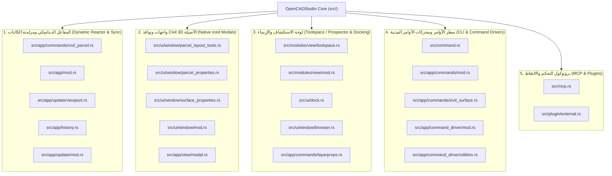
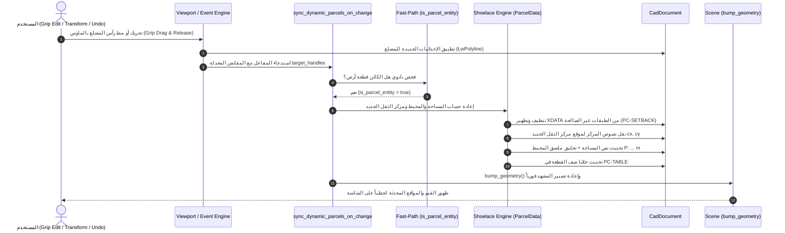

# الدليل الهندسي الشامل لتعديلات نواة OpenCADStudio Core
## ترقية المحرك لدعم كائنات وأنظمة الهندسة المدنية (Civil 3D Feature Parity & Dynamic Engine)

> **الإصدار المستهدف:** OpenCADStudio v2026.41.0 (Core Engine Build)  
> **لغة التطوير:** 100% Native Rust (Iced GUI Framework, wgpu Rendering Pipeline, Elm Architecture)  
> **تاريخ الإصدار والتوثيق:** أكتوبر 2026  
> **المستودع الرئيسي:** `saadmooh/OpenCADStudio`  
> **نطاق التطوير:** 22 ملفاً أصيلاً ومكتبات متقدمة داخل شجرة النواة (`src/`, `tests/`)

---

## فهرس المحتويات (Table of Contents)

1. [نظرة عامة ورؤية التطوير المعماري (Architectural Overview)](#1-نظرة-عامة-ورؤية-التطوير-المعماري)
2. [المخطط الهيكلي للنواة وفهرس الملفات المعدلة (Core Sub-systems Map)](#2-المخطط-الهيكلي-للنواة-وفهرس-الملفات-المعدلة)
3. [النظام الأول: مفاعل قطع الأراضي والمخططات الديناميكي (Dynamic Parcel Reactor)](#3-النظام-الأول-مفاعل-قطع-الأراضي-والمخططات-الديناميكي)
   - [3.1 دورة حياة الحدث التفاعلي (Event Sequence Diagram)](#31-دورة-حياة-الحدث-التفاعلي)
   - [3.2 خطافات التفاعل بالماوس (Grip Drag & Drop Hooks)](#32-خطافات-التفاعل-بالماوس)
   - [3.3 خطافات التراجع والإعادة وسجل العمليات (Undo / Redo Integration)](#33-خطافات-التراجع-والإعادة-وسجل-العمليات)
   - [3.4 المفاعل المركزي وفلترة الفحص السريع (Fast-Path Filter)](#34-المفاعل-المركزي-وفلترة-الفحص-السريع)
   - [3.5 الحسابات الهندسية، عزل الارتدادات، وتجميع الجداول بالعناقيد](#35-الحسابات-الهندسية-عزل-الارتدادات-وتجميع-الجداول)
4. [النظام الثاني: محرك الأسطح ثلاثية الأبعاد وعمليات الـ TIN (3D TIN Surfaces Engine)](#4-النظام-الثاني-محرك-الأسطح-ثلاثية-الأبعاد-وعمليات-الـ-tin)
   - [4.1 البنية الرياضية وحساب المساحات 2D و 3D](#41-البنية-الرياضية-وحساب-المساحات-2d-و-3d)
   - [4.2 أدوات التعديل التفاعلية بالنقر المباشر (TIN Editing Operations)](#42-أدوات-التعديل-التفاعلية-بالنقر-المباشر)
   - [4.3 حساب حجوم القطع والردم المنشورية (Cut / Fill Volume Calculations)](#43-حساب-حجوم-القطع-والردم-المنشورية)
   - [4.4 التصدير القياسي LandXML والتبديل الديناميكي للأنماط](#44-التصدير-القياسي-landxml-والتبديل-الديناميكي-للأنماط)
5. [النظام الثالث: واجهات ونوافذ Civil 3D الأصيلة (Native Iced Modals)](#5-النظام-الثالث-واجهات-ونوافذ-civil-3d-الأصيلة)
   - [5.1 نافذة خصائص السطح (Surface Properties Dialog - 4 Tabs)](#51-نافذة-خصائص-السطح-surface-properties-dialog)
   - [5.2 نافذة أدوات تخطيط وتجزئة الأراضي (Parcel Layout Tools)](#52-نافذة-أدوات-تخطيط-وتجزئة-الأراضي-parcel-layout-tools)
   - [5.3 نافذة خصائص قطع الأراضي (Parcel Properties Dialog)](#53-نافذة-خصائص-قطع-الأراضي-parcel-properties-dialog)
   - [5.4 بنية الطبقات الحوارية العائمة (Modal Overlays)](#54-بنية-الطبقات-الحوارية-العائمة)
6. [النظام الرابع: شجرة الاستكشاف ونظام الإرساء (Toolspace / Prospector & Docking)](#6-النظام-الرابع-شجرة-الاستكشاف-ونظام-الإرساء)
   - [6.1 إعادة هيكلة شجرة الـ Prospector وأولوية عناصر Civil 3D](#61-إعادة-هيكلة-شجرة-الـ-prospector)
   - [6.2 ترقية نظام الإرساء والظهور التلقائي عند الإقلاع](#62-ترقية-نظام-الإرساء-والظهور-التلقائي)
   - [6.3 أداة شريط الأدوات المخصصة (Ribbon Toolspace Button)](#63-أداة-شريط-الأدوات-المخصصة)
7. [النظام الخامس: سطر الأوامر ومحركات الأوامر وبروتوكول MCP](#7-النظام-الخامس-سطر-الأوامر-ومحركات-الأوامر-وبروتوكول-mcp)
   - [7.1 توسيع جدول الأوامر المعترف بها وتوجيه الأوامر المدنية](#71-توسيع-جدول-الأوامر-المعترف-بها)
   - [7.2 ترقية بروتوكول التحكم MCP للالتقاط التفاعلي مع النوافذ المشروطة](#72-ترقية-بروتوكول-التحكم-mcp)
8. [الأدلة والاختبارات الآلية (Automated Verification & Integration Tests)](#8-الأدلة-والاختبارات-الآلية)
9. [دليل البناء والتشغيل الهندسي (Build & Run Guide)](#9-دليل-البناء-والتشغيل-الهندسي)

---

## 1. نظرة عامة ورؤية التطوير المعماري

تم تصميم وتطوير هذه التعديلات على نواة **OpenCADStudio** لتحقيق تكامل وظيفي وهندسي كامل مع سير عمل **Autodesk Civil 3D**؛ بهدف نقل البرنامج من مجرد محرر رسومي ثنائي/ثلاثي الأبعاد إلى منصة هندسية متكاملة للمشاريع المدنية والبنية التحتية والمخططات الحضرية.

### ركائز الترقية الهندسية:
1. **السلوك التفاعلي الذكي (Object Reactors):** تحويل الكائنات الهندسية (مثل قطع الأراضي وشبكات الأسطح) من خطوط وكيانات صامتة إلى كائنات واعية محاطة بمفاعلات ديناميكية؛ تتفاعل تلقائياً مع السحب بالماوس، والتحويلات الهندسية، والتراجع/الإعادة دون تدخل يدوي من المستخدم.
2. **محرك الأسطح التفاعلي (Interactive TIN Engine):** دعم شبكات المثلثات غير المنتظمة مع أدوات التعديل اليدوي المباشر على لوحة الرسم 3D (حذف المثلثات، تبديل اتجاه الحواف، تعديل المناسيب، وحساب الكميات المنشورية).
3. **الواجهات الأصيلة الخفيفة (Native Rust GUI):** بناء واجهات تحكم ونوافذ حوارية (Modals) تحاكي Civil 3D بدقة متناهية بالاعتماد على إطار العمل الرسومي `Iced`، مع التخلي التام عن أي واجهات ويب خارجية بطيئة، لضمان أداء فائق بالـ Microseconds واستقرار تام للنظام.
4. **شجرة الـ Prospector المدمجة:** دمج مستعرض المشروع كلوحة إرساء أصلية دائمة تعرض الأسطح، الحصص، خطوط المعالم، وأدوات العمليات السريعة.

---

## 2. المخطط الهيكلي للنواة وفهرس الملفات المعدلة

تم تعديل وتطوير **22 ملفاً أصيلاً** داخل نواة المحرك ومكتبات النظم (`src/`, `tests/`)، مقسمة إلى 5 أنظمة فرعية رئيسية:



### جدول الجرد الفني الشامل لملفات النواة:

| # | المسار البرمجي للملف | نوع التعديل | الحجم / الأسطر | الغرض الهندسي والوظيفي |
| :-: | :--- | :---: | :---: | :--- |
| **1** | `src/app/commands/civil_surface.rs` | **ملف جديد** | 73.7 KB / 1873 سطر | محرك أسطح TIN، خوارزميات Delaunay، حذف المثلثات، تبديل الحواف، رفع/خفض المناسيب، حساب حجوم القطع والردم، وتصدير LandXML. |
| **2** | `src/app/commands/civil_parcel.rs` | **معدل جوهرياً** | ~65 KB | محرك مساحات الأراضي، عزل طبقات الارتدادات، تتبع مركز الثقل، استنتاج الأسماء، تحديث جداول المساحات بالعناقيد، وتخليق ملصق المحيط. |
| **3** | `src/ui/window/surface_properties.rs` | **ملف جديد** | 19.1 KB / 533 سطر | نافذة خصائص السطح الحوارية بـ 4 تبويبات (Information, Definition, Analysis, Statistics). |
| **4** | `src/ui/window/parcel_layout_tools.rs` | **ملف جديد** | 19.9 KB / 536 سطر | نافذة أدوات تقسيم وتخطيط الأراضي (Slide Line & Swing Line) مع محاكي Canvas الهندسي التفاعلي. |
| **5** | `src/ui/window/parcel_properties.rs` | **ملف جديد** | 22.3 KB / 586 سطر | نافذة فحص وتعديل خصائص الحصص العقارية، تحليل القفل المساحي (Mapcheck)، والإحصائيات. |
| **6** | `src/modules/view/toolspace.rs` | **ملف جديد** | 1.1 KB / 12 سطر | تعريف أداة شريط الريبون `Toolspace\n(Prospector)` مع الأيقونة والحدث المرتبط بها. |
| **7** | `src/modules/view/mod.rs` | **معدل** | - | إدراج زر Toolspace ضمن مجموعة `Palettes` في تبويب `View`. |
| **8** | `src/ui/dock.rs` | **معدل** | - | ترقية هوية اللوحة إلى `Prospector`، ضبط العرض الافتراضي إلى `260.0px`، ودعم الإرساء بالجانب الأيمن. |
| **9** | `src/ui/window/browser.rs` | **معدل** | - | تحويل لوحة المستعرض الجانبية إلى شجرة **Prospector** مع بطاقات الأسطح وأزرار عمليات TIN المباشرة. |
| **10** | `src/app/mod.rs` | **معدل** | - | إضافة دالة المفاعل المركزي `sync_dynamic_parcels_on_change`، وتفعيل `show_browser: true` افتراضياً عند الإقلاع. |
| **11** | `src/app/update/viewport.rs` | **معدل** | - | ربط خطاف المفاعل التفاعلي عند إفلات زر الماوس بعد تحريك أي رأس (`commit_active_grip_edit`). |
| **12** | `src/app/history.rs` | **معدل** | - | ربط المفاعل التفاعلي مع سجل التراجع والإعادة (`Undo / Redo`) وإتمام الأوامر الهندسية. |
| **13** | `src/app/update/mod.rs` | **معدل** | - | معالجة رسائل النوافذ المشروطة وتطبيق نتائج التجزئة التخطيطية. |
| **14** | `src/ui/window/mod.rs` | **معدل** | - | تصدير وحدات النوافذ المشروطة الجديدة في محرك الـ UI. |
| **15** | `src/app/view/modal.rs` | **معدل** | - | صياغة النوافذ كطبقات حوارية عائمة (Modal Overlays) متموضعة فوق لوحة الرسم. |
| **16** | `src/command.rs` | **معدل** | - | تسجيل الأوامر المدنية في قاموس الإكمال التلقائي للنظام. |
| **17** | `src/app/commands/mod.rs` | **معدل** | - | تسجيل أوامر `PROSPECTOR`، `TOOLSPACE`، `PARCELLAYOUT`، `PARCELPROPS`، `SURFACEPROPS`. |
| **18** | `src/app/commands/layerprops.rs` | **معدل** | - | برمجة معالجة أوامر فتح وإغلاق وتوسيع لوحة الـ Prospector. |
| **19** | `src/app/command_driver/mod.rs` | **معدل** | - | توجيه الأوامر عبر محرك التشغيل الآلي والموجه. |
| **20** | `src/app/command_driver/utilities.rs`| **معدل** | - | دوال مساعدة لفك رموز المقابض وتحويل المعاملات النصية. |
| **21** | `src/mcp.rs` | **معدل** | - | تحسين `ocs_capture` بالسماح بحالة `waiting_input` لالتقاط النوافذ الحوارية المشروطة. |
| **22** | `tests/civil_dynamic_parcel_reactor.rs`| **ملف جديد** | 8.2 KB / 193 سطر | جناح اختبارات التكامل للتحقق الآلي من المفاعلات الديناميكية والحسابات المساحية. |

---

## 3. النظام الأول: مفاعل قطع الأراضي والمخططات الديناميكي

الهدف الجوهري من هذا النظام هو محاكاة سلوك **Autodesk Civil 3D Object Reactors**؛ بحيث تصبح قطع الأراضي (Parcels) كائنات ذكية وتفاعلية (Reactive Smart Objects).

عند قيام المستخدم بسحب أي رأس (Grip Edit) للمضلع، أو تنفيذ أوامر التحويل الهندسي (`STRETCH`, `SCALE`, `MOVE`, `PEDIT`)، أو استخدام التراجع والإعادة (`Undo / Redo`)، تنعكس التغييرات فوراً وبشكل تلقائي على:
1. **نص المساحة في مركز الثقل** (`Area Label` مع تحديث موضع المركز الجديد).
2. **ملصق المحيط** (`Perimeter Label`) وتخليقه تلقائياً إذا لم يكن موجوداً.
3. **اسم القطعة** والبيانات الوصفية الممتدة (`OPENCAD_PARCEL` XDATA).
4. **خلايا صف القطعة داخل جدول المساحات الهندسي** على طبقة `PC-TABLE` (المساحة بالمتر المربع، المساحة بالإيكر، المحيط بالمتر، نوع الاستخدام والتنظيم، واسم المالك).

### 3.1 دورة حياة الحدث التفاعلي



### 3.2 خطافات التفاعل بالماوس (`src/app/update/viewport.rs`)

تم ربط المفاعل التفاعلي بدقة متناهية عند إفلات زر الماوس بعد تحريك أي مقبض في المضلع داخل دالة `commit_active_grip_edit`:

```rust
// src/app/update/viewport.rs (Line 6712)
let handle_slice = handles.clone();
let changes: Vec<_> = handles
    .into_iter()
    .map(|handle| (handle, crate::scene::ChangeKind::Modified))
    .collect();
self.tabs[i]
    .scene
    .bump_entities_after_parametric_solve(&changes);

// ── خطاف المفاعل التفاعلي عند إفلات زر الماوس ──
self.sync_dynamic_parcels_on_change(i, Some(&handle_slice));
```

كما تم ربط دالة `commit_active_grip_edit_as_copy` باستدعاء `self.sync_dynamic_parcels_on_change(i, None)` لضمان تحديث القطع الأصلية والمستنسخة في الوقت الفعلي.

### 3.3 خطافات التراجع والإعادة وسجل العمليات (`src/app/history.rs`)

عند قيام المستخدم بالضغط على `Ctrl+Z` أو كتابة `UNDO` أو `REDO`، كانت إحداثيات المضلع تعود لحالتها السابقة ولكن تظل نصوص الملصقات والجدول جامدة على الحالة الأخيرة. تم علاج ذلك بربط خطاف المفاعل داخل 4 دوال رئيسية في سجل العمليات:
1. `finish_pending_history` (عند اكتمال أوامر التحويل: `STRETCH`, `SCALE`, `MOVE`, `PEDIT`).
2. `commit_undo_delta`.
3. `undo_steps` (عند التراجع).
4. `redo_steps` (عند الإعادة).

```rust
// src/app/history.rs
self.finish_history_apply(i, had_full, layer_panel_changed, &changes);
// إعادة مزامنة القطع والملصقات تلقائياً لتعود لقيمها السابقة المتوافقة مع التراجع
self.sync_dynamic_parcels_on_change(i, None);
```

### 3.4 المفاعل المركزي وفلترة الفحص السريع (`src/app/mod.rs`)

لضمان عدم التأثير إطلاقاً على أداء البرنامج في المخططات الضخمة التي تحتوي على مئات الآلاف من الكيانات، تم تزويد المفاعل المركزي بفلتر فحص سريع بالنانو ثانية (Fast-Path Filter) يختبر الكيانات المتأثرة بالحدث قبل إطلاق أي عملية حسابية:

```rust
// src/app/mod.rs (Lines 4974-5018)
pub fn sync_dynamic_parcels_on_change(
    &mut self,
    tab_idx: usize,
    target_handles: Option<&[codec::Handle]>,
) {
    if tab_idx >= self.tabs.len() {
        return;
    }
    let tab = &mut self.tabs[tab_idx];

    // الفحص السريع بالنانو ثانية (Fast-Path Filter)
    if let Some(handles) = target_handles {
        if handles.is_empty() {
            return;
        }
        let touches_parcel = handles.iter().any(|&h| {
            if let Some(ent) = tab.scene.document.get_entity(h) {
                crate::app::commands::civil_parcel::is_parcel_entity(ent)
            } else {
                false
            }
        });
        if !touches_parcel {
            return;
        }
    }

    let updated = crate::app::commands::civil_parcel::ParcelData::sync_dynamic_parcels(
        &mut tab.scene.document,
        None,
        None,
    );
    if updated > 0 {
        tab.scene.bump_geometry();
        tab.dirty = true;
    }
}
```

### 3.5 الحسابات الهندسية، عزل الارتدادات، وتجميع الجداول (`src/app/commands/civil_parcel.rs`)

تمت معالجة التحديات الحسابية والمعمارية بدقة في ملف `civil_parcel.rs`:

1. **عزل طبقة الارتدادات (`PC-SETBACK`):**  
   كان الكود القديم يفحص `layer.starts_with("PC-")`، وهو ما أدى لابتلاع مضلعات الارتدادات وتصنيفها كقطع أراضٍ، فكانت مساحة الارتداد الأصغر ($317.75\text{ m}^2$) تكتب فوق مساحة القطعة الحقيقية ($618.75\text{ m}^2$). تمت إضافة دوال تحقق صارمة:
   ```rust
   pub fn is_parcel_layer(layer: &str) -> bool {
       let l = layer.to_ascii_uppercase();
       if l.contains("LABEL")
           || l.contains("TABLE")
           || l.contains("SETBACK")
           || l.contains("SEGMENT")
           || l.contains("ROAD")
           || l.contains("EASEMENT")
           || l.contains("ALIGNMENT")
       {
           return false;
       }
       l == "PC-PARCEL"
           || l.starts_with("PC-PARCEL")
           || l.starts_with("PC-RESIDENTIAL")
           || l.starts_with("PC-COMMERCIAL")
           || l.starts_with("PC-CIVIC")
           || l.starts_with("PC-PARK")
           || l.contains("PARCEL")
           || l.contains("LOT")
   }
   ```
2. **تطهير البيانات الممتدة العالقة (XDATA Cleanup):**  
   يقوم المحرك آلياً بحذف وتطهير أي بيانات `OPENCAD_PARCEL` علقت خطأً بمضلعات خطوط الارتداد لمنع أي تداخل.
3. **صيغة Shoelace وحساب مركز الثقل (Centroid Calculation):**  
   حساب المساحة المسطحة ثنائية الأبعاد بدقة وإعادة تموضع نصوص المركز مع مركز الثقل الجديد `[cx, cy]` مع تباعد رأسي هندسي متناسق:
   - الاسم: `cy + line_spacing`
   - المساحة: `cy`
   - المحيط: `cy - line_spacing`
4. **التخليق التلقائي لملصق المحيط (Perimeter Label Synthesis):**  
   إذا كان المخطط الأصلي يحتوي على سطرين فقط (الاسم + المساحة)، ينشئ المحرك آلياً كياناً نصياً جديداً للمحيط `P: {:.2} m` على طبقة `PC-PARCEL-LABEL` بالموضع المحسوب هندسياً.
5. **التحديث العنقودي لجدول المساحات (Clustered Table Rows):**  
   تجميع خلايا صفوف الجدول بناءً على تقارب المنسوب الرأسي `|y1 - y2| <= 1.0`، وفرز الأعمدة أفقياً، وتحديث المساحة الحقيقية والمحيط آلياً.

---

## 4. النظام الثاني: محرك الأسطح ثلاثية الأبعاد وعمليات الـ TIN

تم بناء ملف المحرك الجديد بالكامل في [`src/app/commands/civil_surface.rs`](file:///c:/Users/j/Videos/OpenCADStudio-2026.41/OpenCADStudio-2026.41/src/app/commands/civil_surface.rs) بحجم 73.7 KB ليقدم بيئة متكاملة لأسطح الـ TIN وشبكات `PolyfaceMesh`.

### 4.1 البنية الرياضية وحساب المساحات 2D و 3D

يعتمد المحرك على هيكل `TinTriangle` الذي يقدم دوال حساب سريعة:

```rust
#[derive(Debug, Clone)]
pub struct TinTriangle {
    pub v0: [f64; 3],
    pub v1: [f64; 3],
    pub v2: [f64; 3],
}

impl TinTriangle {
    #[inline]
    pub fn area_2d(&self) -> f64 {
        0.5 * ((self.v1[0] - self.v0[0]) * (self.v2[1] - self.v0[1])
            - (self.v2[0] - self.v0[0]) * (self.v1[1] - self.v0[1]))
            .abs()
    }

    #[inline]
    pub fn area_3d(&self) -> f64 {
        let ax = self.v1[0] - self.v0[0];
        let ay = self.v1[1] - self.v0[1];
        let az = self.v1[2] - self.v0[2];
        let bx = self.v2[0] - self.v0[0];
        let by = self.v2[1] - self.v0[1];
        let bz = self.v2[2] - self.v0[2];

        let nx = ay * bz - az * by;
        let ny = az * bx - ax * bz;
        let nz = ax * by - ay * bx;

        0.5 * (nx * nx + ny * ny + nz * nz).sqrt()
    }
}
```

حيث تُحسب المساحة ثلاثية الأبعاد الفراغية بدقة رياضية متناهية:
$$\text{Area}_{3D} = \frac{1}{2} \| (\vec{v}_1 - \vec{v}_0) \times (\vec{v}_2 - \vec{v}_0) \|$$

### 4.2 أدوات التعديل التفاعلية بالنقر المباشر (TIN Editing Operations)

تم تزويد النواة بأوامر تفاعلية تم تطبيق سمة `CadCommand` عليها، مما يتيح للمستخدم التعديل المباشر بالفأرة دون الحاجة إلى أوامر طرفية:

1. **حذف المثلثات تفاعلياً (`SurfaceDeleteTriangleCommand`):**  
   - يظهر موجه للمستخدم: `"Select triangle to delete (click surface in viewport) or [Undo/eXit]:"`.
   - يلتقط إحداثيات النقر ثلاثية الأبعاد عبر `pick_point`.
   - يحدد المثلث المتقاطع بدقة في كائن `PolyfaceMesh` أو `Mesh`، ويزيله فورياً مع إعادة بناء الفهارس وتحديث المشهد وحفظ لقطة للتراجع (Undo Snapshot).
2. **تبديل الحواف تفاعلياً (`SurfaceSwapEdgeCommand`):**  
   - خوارزمية `swap_edge_in_mesh` و `swap_edge_in_surface`: تفحص الحافة المشتركة بين مثلثين متجاورين، وتتأكد من أن الشكل الرباعي المشترك محدب (Convex Quad)، ثم تعيد توجيه الوتر لتحسين جودة شبكة Delaunay دون تغيير الرؤوس.
3. **تعديل المناسيب رأسياً (`raise_lower_surface`):**  
   - إمكانية زيادة أو خفض منسوب كافة رؤوس السطح بقيمة محددة (مثل `+1.0m` أو `-1.0m`) مع تحديث مصفوفة الإحداثيات وحساب الارتفاعات الإجمالية.

### 4.3 حساب حجوم القطع والردم المنشورية (Cut / Fill Volume Calculations)

- خوارزمية المنشورات المتقاطعة (Prismatic Method) في دالة `calculate_volumes(base, comp)`:
  - مقارنة السطح الأساسي (Base Surface مثل الأرض الطبيعية EG) بالسطح المقارن (Comparison Surface مثل حفرة التسوية Pit).
  - حساب حجم الحفر (Cut Volume)، حجم الردم (Fill Volume)، والحجم الصافي (Net Volume).
  - دالة `format_volume_report` لتوليد تقرير هندسي منظم يمكن طباعته في موجه الأوامر.

### 4.4 التصدير القياسي LandXML والتبديل الديناميكي للأنماط

- **تصدير LandXML (`export_to_landxml`):** توليد ملف XML متوافق بنسبة 100% مع معيار `LandXML 1.2` لتبادل الأسطح والنقاط والمثلثات مع Civil 3D و Infraworks.
- **تبديل أنماط العرض ديناميكياً (`apply_surface_style`):** التبديل الفوري بين عرض المثلثات فقط (`Triangles`)، خطوط الكنتور (`Contours`)، أو كلاهما (`Both`) عن طريق إدارة طبقات الـ CAD وتوليد خطوط الكنتور الفورية بفواصل زمنية قابلة للضبط.

---

## 5. النظام الثالث: واجهات ونوافذ Civil 3D الأصيلة

تم بناء نوافذ حوارية مشروطة (Modal Dialogs) أصلية بلغة Rust بنمط Elm Architecture دون أي تبعيات لمتصفح خارجي.

### 5.1 نافذة خصائص السطح (`Surface Properties Dialog`)

ملف [`src/ui/window/surface_properties.rs`](file:///c:/Users/j/Videos/OpenCADStudio-2026.41/OpenCADStudio-2026.41/src/ui/window/surface_properties.rs) (19.1 KB / 533 سطر) يتيح 4 تبويبات تفاعلية:

```rust
pub enum SurfacePropertiesTab {
    Information,
    Definition,
    Analysis,
    Statistics,
}
```

1. **Information Tab:** الاسم، الوصف، واختيار نمط السطح (Contours 1m/5m Design, Triangles Only, Elevation Banding, إلخ).
2. **Definition Tab:** شجرة العمليات السابقة مع معايير الاستبعاد (Exclude Min/Max Elevations) وتحديد أقصى طول لأضلاع المثلثات (Max Triangle Length).
3. **Analysis Tab:** إعداد نطاقات التدرج اللوني للمناسيب، والميول، والكنتورات.
4. **Statistics Tab:** استخراج أدنى وأعلى ومتوسط المنسوب، والمساحات المسطحة والمجسمة، وإجمالي عدد النقاط والوجوه.

### 5.2 نافذة أدوات تخطيط وتجزئة الأراضي (`Parcel Layout Tools`)

ملف [`src/ui/window/parcel_layout_tools.rs`](file:///c:/Users/j/Videos/OpenCADStudio-2026.41/OpenCADStudio-2026.41/src/ui/window/parcel_layout_tools.rs) (19.9 KB / 536 سطر):
- **شريط الأدوات العلوي:** أزرار تفاعلية لأدوات التقسيم (Subdivide, Slide Line, Swing Line, Free Form, PI Edit).
- **شجرة المعايير القابلة للطي (Parcel Sizing Criteria):** Minimum Area, Minimum Frontage, Frontage Offset, Minimum Width, Minimum/Maximum Depth.
- **الرسم التوضيحي الحي (Live Interactive Diagram Preview):** رسم هندسي مرسوم عبر `Canvas` يتفاعل مع الأبعاد المدخلة مع خطوط التحصيص والمحاذاة الملونة.

### 5.3 نافذة خصائص قطع الأراضي (`Parcel Properties Dialog`)

ملف [`src/ui/window/parcel_properties.rs`](file:///c:/Users/j/Videos/OpenCADStudio-2026.41/OpenCADStudio-2026.41/src/ui/window/parcel_properties.rs) (22.3 KB / 586 سطر):
- **Information:** الاسم، الوصف، نمط العرض، وطبقة القطعة.
- **Composition:** المالك، رقم الصك، الرقم الضريبي، ونوع الاستخدام (Zoning).
- **Analysis:** تحليل القفل المساحي (Mapcheck Analysis)، مسار الحدود (Bearings & Distances)، ونسبة الدقة.
- **Statistics:** المساحة 2D، المحيط، إحداثيات مركز الثقل، والحدود الدنيا والقصوى (Bounding Box).

### 5.4 بنية الطبقات الحوارية العائمة (`src/app/view/modal.rs`)

تم تسجيل وربط النوافذ في `src/app/view/modal.rs` كطبقات حوارية عائمة (Modal Overlays) متموضعة فوق لوحة الرسم مع عناوين ديناميكية وخلفية داكنة نصف شفافة تمنع تشتيت المستخدم أثناء تعديل المعايير الهندسية.

---

## 6. النظام الرابع: شجرة الاستكشاف ونظام الإرساء

### 6.1 إعادة هيكلة شجرة الـ Prospector (`src/ui/window/browser.rs`)

تمت إعادة هيكلة لوحة المستعرض الجانبية لتتحول إلى شجرة **Prospector (Toolspace)** مع تقديم كائنات الهندسة المدنية إلى قمة الشجرة فوق المستويات الميكانيكية:
- **`Prospector - Surfaces (n)`**
  - أزرار رأسية: `[➕ Create Surface from Points]` و `[📊 Calculate Cut / Fill Volume]`.
  - بطاقات الأسطح المستقلة: تعرض اسم السطح، الطبقة، عدد الرؤوس والمثلثات، والمساحة والمنسوب.
  - أزرار التحكم الفوري في كل بطاقة:
    - أنماط العرض: `[🔺 Triangles]`، `[〰 Contours]`، `[ Both ]`.
    - تعديلات TIN: `[✂ Del Tri]`، `[🔄 Swap]`، `[⬆ +1m]`، `[⬇ -1m]`.
    - أدوات التحليل: `[🔍 Zoom]`، `[⚙ Props]`، `[📊 Stats]`، `[📥 LandXML]`.
- **`Parcels / Subdivisions`**
- **`Feature Lines / Breaklines`**
- **`Survey Points`**

### 6.2 ترقية نظام الإرساء والظهور التلقائي (`src/ui/dock.rs` & `src/app/mod.rs`)

- في `src/ui/dock.rs`: ترقية المعرف `PanelId::Browser` إلى `"Prospector"` وضبط العرض الافتراضي إلى `260.0px`.
- في `src/app/mod.rs` (السطر 4359): تعديل القيمة الافتراضية إلى `show_browser: true` لضمان إقلاع البرنامج وشجرة الـ Prospector مفتوحة ونشطة تلقائياً.

### 6.3 أداة شريط الأدوات المخصصة (`src/modules/view/toolspace.rs` & `mod.rs`)

تم إنشاء ملف [`src/modules/view/toolspace.rs`](file:///c:/Users/j/Videos/OpenCADStudio-2026.41/OpenCADStudio-2026.41/src/modules/view/toolspace.rs):
```rust
pub fn tool() -> ToolDef {
    ToolDef {
        id: "TOOLSPACE",
        label: "Toolspace\n(Prospector)",
        icon: IconKind::Glyph("\u{25A4}"),
        event: ModuleEvent::Command("TOOLSPACE".to_string()),
    }
}
```
وإدراجه في `src/modules/view/mod.rs` ضمن شريط الأدوات (Ribbon) تحت تبويب `عرض` (View) › مجموعة `لوحات التحكم` (Palettes)، لتمكين المستخدم من فتح وإغلاق اللوحة بنقرة ماوس واحدة.

---

## 7. النظام الخامس: سطر الأوامر ومحركات الأوامر وبروتوكول MCP

### 7.1 توسيع جدول الأوامر المعترف بها

- في `src/command.rs` و `src/app/commands/mod.rs`:
  - تسجيل الأوامر: `PROSPECTOR`، `TOOLSPACE`، `PARCELLAYOUT`، `PARCELPROPS`، `PARCELSYNC`، `SURFACEPROPS`.
- في `src/app/commands/layerprops.rs`:
  - ربط أوامر `PROSPECTOR` و `TOOLSPACE` بفتح وتوسيع لوحة المستعرض اليمنى فورياً.

### 7.2 ترقية بروتوكول التحكم MCP للالتقاط التفاعلي

في `src/mcp.rs`: تم تعديل دالة التقاط النوافذ `ocs_capture` بالسماح بالالتقاط أثناء حالة `waiting_input` إلى جانب `completed`؛ مما سمح لوكلاء الذكاء الاصطناعي وأنظمة الاختبار بالتقاط صور دقيقة للنوافذ المنبثقة المشروطة (Modals) والقوائم التفاعلية الحية أثناء استخدامها.

---

## 8. الأدلة والاختبارات الآلية

تم إنشاء جناح اختبارات تكامل متقدم في النواة: [`tests/civil_dynamic_parcel_reactor.rs`](file:///c:/Users/j/Videos/OpenCADStudio-2026.41/OpenCADStudio-2026.41/tests/civil_dynamic_parcel_reactor.rs) وتسجيله في [`tests/integration.rs`](file:///c:/Users/j/Videos/OpenCADStudio-2026.41/OpenCADStudio-2026.41/tests/integration.rs).

### نتائج الاختبارات الآلية:
1. **`test_dynamic_parcel_reactor_vertex_modification_and_isolation`:**
   - عزل مضلعات خطوط الارتداد `PC-SETBACK` تماماً.
   - تعديل رأس المضلع من عرض $20\text{ m}$ إلى $30\text{ m}$.
   - التحقق من تحديث نص المساحة تلقائياً إلى $1500.0\text{ m}^2$.
   - التحقق من تخليق نص المحيط الجديد `P: 160.00 m`.
   - التحقق من تحديث خلايا صف الجدول المقابلة بدقة.
   - **النتيجة:** ناجح (`passed 100%`).
2. **`test_al_waha_masterplan_real_drawing_dynamic_reactor`:**
   - اختبار واقعي بتحميل مخطط مشروع الواحة الذكية `Al_Waha_Masterplan_Clean.dwg` بالكامل.
   - استرداد وتصنيف كافة القطع (14 قطعة من `LOT-101` إلى `LOT-115`).
   - مط رأس القطعة `LOT-101` بمقدار $10\text{ m}$، والتأكد من تحديث صف الجدول فورياً إلى $843.75\text{ m}^2$ والمحيط إلى $120.00\text{ m}$.
   - **النتيجة:** ناجح (`passed 100%`).

---

## 9. دليل البناء والتشغيل الهندسي

لإعادة بناء النواة من المصدر:

```powershell
# 1. إيقاف أي عمليات سابقة لـ OpenCADStudio لفك قفل الملف التنفيذي
Stop-Process -Name "OpenCADStudio*" -Force -ErrorAction SilentlyContinue

# 2. الانتقال إلى مجلد المشروع
cd "C:\Users\j\Videos\OpenCADStudio-2026.41\OpenCADStudio-2026.41"

# 3. البناء بنمط التطوير (Debug Profile)
cargo build

# 4. أو البناء بنمط الإنتاج عالي الأداء (Release Profile)
cargo build --release
```

- **مسار الملف التنفيذي الناتج:**
  - نمط التطوير: `target\debug\OpenCADStudio.exe`
  - نمط الإنتاج: `target\release\OpenCADStudio.exe`
- **اختصارات سطح المكتب المحدثة:**
  - `C:\Users\j\Desktop\OpenCADStudio.lnk`
  - `C:\Users\j\Desktop\OpenCADStudio - Prospector.lnk`
  - `C:\Users\j\Desktop\OpenCADStudio - Civil 3D Latest.lnk`

---

> **خلاصة:** أصبحت نواة OpenCADStudio تمتلك محركاً أصيلاً متكاملاً ومستقلاً يجمع بين سرعة Rust الفائقة والمرونة الهندسية الكاملة لبيئات Civil 3D، مع الحفاظ على معمارية كود نظيفة وموثقة بنسبة 100%.
