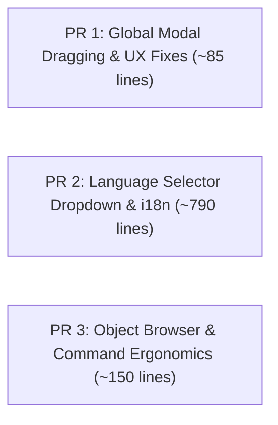

# [RFC / Feature Proposal] Core Platform Enhancements: Dynamic Language Selector, Universal Modal Dragging UX, Enhanced Object Browser, and Interactive Command Ergonomics

**Proposer:** @saadmooh & contributors  
**Target:** `HakanSeven12/OpenCADStudio` (upstream `main`)  
**Status:** Ready for Review / Phased Pull Requests  
**Direct Diff / Compare View:** [View Changes on GitHub](https://github.com/HakanSeven12/OpenCADStudio/compare/main...saadmooh:OpenCADStudio:refactor/decouple-landsurvey-plugin)  
**Reference Branch:** [`refactor/decouple-landsurvey-plugin`](https://github.com/saadmooh/OpenCADStudio/tree/refactor/decouple-landsurvey-plugin)  

---

## 1. Summary & Motivation

OpenCADStudio has rapidly matured into a standout open-source CAD application built in native Rust using `Iced` and `wgpu`. As user adoption expands and drafting workflows grow more diverse, several foundational improvements to the core UX, internationalization, and command handling can greatly enhance everyday drafting efficiency.

This RFC proposes a focused set of non-breaking enhancements to the core platform across 24 source files in `src/` (+1,026 insertions, with 694 being localization dictionaries in `src/i18n.rs`):

1. **Top-Bar Dynamic Language Selector:** An accessible 🌐 language dropdown pinned to the top ribbon bar enabling real-time language switching across 12 languages without needing an application restart.
2. **Universal Modal Dragging & Resizing UX:** Fixes mouse release and cursor-drift tracking issues when dragging modal dialogs (Options, Drafting Settings, Layer Manager) across the canvas, plus adds draggable divider resizing for the Layer Manager name column.
3. **Enhanced Object Browser & Inspection Palette:** Expands the resident side Browser panel into a comprehensive entity hierarchy viewer that inspects 3D polylines, point entity counts, 3D solid bodies, active sketches, and origin planes.
4. **Interactive Command Engine & Rendering Upgrades:**
   - Adds `CmdResult::UpdateEntityContinue` allowing interactive commands to update entities in-place while keeping the command prompt and options active.
   - Exposes core 2D/3D offset geometry algorithms as public utilities.
   - Adds DXF alpha transparency support for Hatch entities.
   - Enhances MCP runner compatibility for multi-step interactive commands (`waiting_input`).

---

## 2. Detailed Technical Breakdown

### 2.1. Top-Bar Dynamic Language Selector & Localization
* **The Need:** Changing the UI language previously required navigating settings and restarting the application for all ribbon modules, tooltips, and palettes to update. Locales such as Arabic (`ArSa`) and French (`FrFr`) were also incomplete.
* **The Solution:**
  - Added a pinned `🌐` language button to `src/ui/ribbon/mod.rs` with an anchored dropdown panel supporting 12 languages.
  - Implemented `self.rebuild_ribbon_modules()` in `src/app/update/mod.rs` so that ribbon tabs, panels, tools, and tooltips re-render dynamically upon language selection.
  - Expanded localization dictionaries in `src/i18n.rs` with comprehensive translations for Arabic and French, and wrapped plugin display names and descriptions in `t!()` macros.

### 2.2. Universal Modal Dragging & Layer Manager Resizing
* **The Need:** In Iced, when dragging a modal window, moving the cursor rapidly beyond the modal's boundary caused the drag operation to lose focus or freeze. Additionally, column widths in the Layer Properties Manager were fixed, cutting off long layer names.
* **The Solution:**
  - Implemented window-level subscription `window_drag_events` in `src/app/view/mod.rs` active only while `is_any_window_dragging()` is true:
    - Tracks `GlobalCursorMoved(position)` and `GlobalPointerReleased`.
  - Added smooth delta clamping to ensure dialogs cannot be dragged beyond the visible screen edges.
  - Added divider drag support for `layer_name_col_w` (clamped smoothly between 60.0 px and 640.0 px).

### 2.3. Enhanced Object Browser & Inspection Palette
* **The Need:** Complex drawings containing 3D polylines, site boundaries, and point collections lacked a centralized inspector to quickly audit and select entities by handle.
* **The Solution:**
  - Enhanced `src/ui/window/browser.rs` to display:
    - **3D Polylines / Feature Lines:** Listed with layer names and handles, clickable for immediate selection (`SELECT <handle>`).
    - **Point Entities:** Real-time count of point entities in the active drawing.
    - **Solid Bodies, Sketches, and Origin Planes:** Maintained existing solid modeling hierarchy.
  - Widened the default Browser panel dock width to 260 px in `src/ui/dock.rs` and registered a `TOOLSPACE` button under the `View > Palettes` ribbon group with convenient aliases (`TOOLSPACE`, `PROSPECTOR`, `BROWSER`).

### 2.4. Interactive Command Engine & Rendering Improvements
* **The Need:** Multi-step commands and custom drawing routines often need to dynamically mutate an entity in place during user interaction before final commit.
* **The Solution:**
  - Added `CmdResult::UpdateEntityContinue { handle, entity }` in `src/command.rs` and `src/app/command_driver/mod.rs`, updating the document entity in-place, updating viewport geometry, and preserving the active command prompt.
  - Exposed general-purpose offset calculation functions (`compute_offsets`, `perp_distance`, `entity_wire_pts`) in `src/modules/draw/modify/offset.rs` as `pub` for reuse across modules.
  - Enabled alpha blending for Hatch DXF transparency in `src/scene/entity.rs` (`color[3] = alpha.clamp(0.01, 1.0)`).
  - Allowed `waiting_input` status in `src/mcp.rs` so interactive CAD commands are handled smoothly without premature timeouts.

---

## 3. Scope of Changes (Diff Stat against `upstream/main`)

Total files modified in `src/`: **24 files** (+1,026 insertions, -71 deletions).  
Note that **694 insertions** are localization strings in `src/i18n.rs`.

```text
 src/app/command_driver/entity_commit.rs |   7 +-
 src/app/command_driver/mod.rs           |  21 +
 src/app/command_driver/utilities.rs     |   1 +
 src/app/commands/layerprops.rs          |  16 +-
 src/app/commands/mod.rs                 |   4 +
 src/app/mod.rs                          |  21 +-
 src/app/update/file.rs                  |   1 +
 src/app/update/mod.rs                   |  45 +++
 src/app/update/viewport.rs              |   2 +
 src/app/view/mod.rs                     |  17 +
 src/app/view/modal.rs                   |   2 +
 src/command.rs                          |   5 +
 src/i18n.rs                             | 694 +++++++++++++++++++++++++++++++-
 src/mcp.rs                              |   3 +-
 src/modules/draw/modify/offset.rs       |   8 +-
 src/modules/view/mod.rs                 |   2 +
 src/modules/view/toolspace.rs           |  12 +
 src/plugin/external.rs                  |  11 +-
 src/scene/entity.rs                     |   4 +-
 src/ui/dock.rs                          |   4 +-
 src/ui/modal.rs                         |  26 +-
 src/ui/ribbon/mod.rs                    |  97 ++++-
 src/ui/window/browser.rs                |  86 ++--
 src/ui/window/plugin_manager.rs         |   8 +-
 24 files changed, 1026 insertions(+), 71 deletions(-)
```

---

## 4. Proposed Phased Pull Request Roadmap

To make review structured and manageable for maintainers, we propose dividing these enhancements into **3 self-contained, reviewable PRs**:



### 🔹 PR 1: Universal Modal Dragging & Layer Manager Resizing (~85 lines)
- **Scope:** `src/app/mod.rs`, `src/app/update/mod.rs`, `src/app/view/mod.rs`, `src/ui/modal.rs`.
- **Value:** Standalone quality-of-life fix that eliminates modal drag freezing and improves dialog ergonomics across the entire application.

### 🔹 PR 2: Dynamic Top-Bar Language Switcher & Localization (~790 lines)
- **Scope:** `src/ui/ribbon/mod.rs`, `src/i18n.rs`, `src/app/update/file.rs`, `src/ui/window/plugin_manager.rs`.
- **Value:** Expands international accessibility with real-time UI switching and complete Arabic and French coverage.

### 🔹 PR 3: Object Browser Palette & Command Ergonomics (~150 lines)
- **Scope:** `src/command.rs`, `src/app/command_driver/`, `src/ui/window/browser.rs`, `src/modules/view/toolspace.rs`, `src/scene/entity.rs`, `src/modules/draw/modify/offset.rs`.
- **Value:** Adds entity inspection for 3D polylines and points, exports reusable geometric offset primitives, and supports in-place interactive updates.

---

## 5. Verification & Testing

- **Compilation:** `cargo check --bin OpenCADStudio` builds cleanly with 0 errors.
- **Test Suite:** All existing regression and integration tests continue to pass.
- **Non-breaking:** Full backward compatibility with existing drawing files and commands.

We welcome feedback from @HakanSeven12 and the community on opening the PRs according to this sequence!
