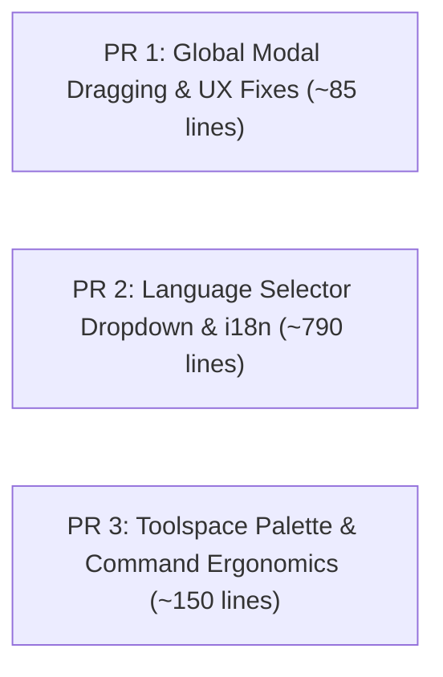

# [RFC / Feature Proposal] Core Platform Enhancements: Dynamic Language Switcher, Global Modal Dragging UX, Prospector Palette, and Plugin Host Ergonomics

**Proposer:** @saadmooh & Antigravity  
**Target:** `HakanSeven12/OpenCADStudio` (upstream `main`)  
**Status:** Ready for Review / Phased Pull Requests  
**Reference Branch:** [`refactor/decouple-landsurvey-plugin`](https://github.com/saadmooh/OpenCADStudio/tree/refactor/decouple-landsurvey-plugin)  

---

## 1. Summary & Motivation

OpenCADStudio has established itself as the leading high-performance open-source CAD system written in Rust with `Iced` and `wgpu`. 

To support modern modularity and vertical extensions (such as Land Survey, Civil 3D workflows, and GIS), domain-specific tools (e.g., Civil Parcels and 3D TIN Surfaces) have been cleanly decoupled into standalone external plugins (`opencad-parcels-plugin` and `opencad-landsurvey-plugin`).

Consequently, the core changes required in OpenCADStudio itself are **minimal, clean, and highly general-purpose**. This proposal outlines targeted enhancements to the core engine across 24 files (+1,026 insertions, 694 of which are internationalization translations in `src/i18n.rs`):

1. **Top-Bar Dynamic Language Selector & Ribbon Rebuild:** A top-bar 🌐 dropdown supporting on-the-fly language switching across 12 languages (including comprehensive Arabic and French translations) without needing an application restart.
2. **Universal Modal Dragging & Resizing UX:** Fixes mouse release/move loss when the cursor moves outside modal dialog borders via global cursor tracking (`GlobalCursorMoved`, `GlobalPointerReleased`), plus draggable Layer Manager column widths.
3. **Prospector / Toolspace Palette:** Upgrades the docked side Browser into a versatile Prospector panel capable of inspecting 3D polylines, feature lines, survey point counts, solid bodies, and origin planes.
4. **Plugin Host & Command Ergonomics:**
   - Adds `CmdResult::UpdateEntityContinue` to allow interactive/real-time modification of entities in place.
   - Exports general-purpose geometric offset utilities (`compute_offsets`, `perp_distance`, `entity_wire_pts`) as `pub`.
   - Supports alpha transparency in Hatch entity rendering.
   - Permits `waiting_input` status in MCP GUI integration.

---

## 2. Detailed Technical Breakdown

### 2.1. Top-Bar Dynamic Language Selector & i18n
* **Problem:** Changing language previously required diving into settings or restarting to update all ribbon modules and toolbars. Arabic (RTL/MENA) and French locales were also incomplete.
* **Solution:**
  - Added a pinned `🌐 Language` button in `src/ui/ribbon/mod.rs` with an anchored dropdown panel.
  - Added `self.rebuild_ribbon_modules()` in `src/app/update/mod.rs` so that ribbon tabs, tooltips, and labels immediately reflect the selected language.
  - Added comprehensive localization dictionaries in `src/i18n.rs` for Arabic (`ArSa`) and French (`FrFr`), covering CAD tools, ribbon titles, and plugin manager cards (`t!(p.name)`, `t!(p.description)`).

### 2.2. Universal Global Modal Dragging & Layer Column Resizing
* **Problem:** In Iced, when dragging a modal window (e.g., Layer Manager, Options, or Drafting Settings), if the cursor moves rapidly and exits the title bar or modal boundary, tracking is lost. In addition, column widths in the Layer Manager were fixed.
* **Solution:**
  - Implemented window-level subscription `window_drag_events` in `src/app/view/mod.rs` active only while `is_any_window_dragging()` is true:
    - Tracks `GlobalCursorMoved(position)` and `GlobalPointerReleased`.
  - Added smooth delta clamping to ensure dialogs cannot be dragged off-screen.
  - Enabled divider dragging for `layer_name_col_w` (clamped between 60.0 and 640.0 px).

### 2.3. Prospector / Toolspace Palette
* **Problem:** Civil and infrastructure drawings with 3D feature lines, site breaklines, and survey points lacked a visual tree hierarchy.
* **Solution:**
  - Enhanced `src/ui/window/browser.rs` to display:
    - **Feature Lines / Breaklines:** Automatic listing and selection by handle (`SELECT <handle>`).
    - **Survey Points:** Fast count and entity verification.
    - **Bodies, Sketches, and Origin Planes:** Maintained existing solid modeling hierarchy.
  - Registered `TOOLSPACE` tool under `View > Palettes` ribbon group and allowed `TOOLSPACE` / `PROSPECTOR` command aliases in `src/app/commands/layerprops.rs`.

### 2.4. Plugin Architecture & Command Ergonomics
* **Problem:** External plugins and interactive commands often need to preview or update an entity dynamically before concluding the command.
* **Solution:**
  - `src/command.rs` & `src/app/command_driver/mod.rs`: Added `CmdResult::UpdateEntityContinue { handle, entity }` to update the document entity in place, bump geometry, and keep the interactive prompt active.
  - `src/modules/draw/modify/offset.rs`: Exposed offset calculation primitives as `pub` so external plugins can leverage core geometry algorithms without duplicating math.
  - `src/scene/entity.rs`: Enabled alpha blending for Hatch DXF transparency (`color[3] = alpha.clamp(0.01, 1.0)`).
  - `src/mcp.rs`: Allowed `waiting_input` status for multi-step interactive command dispatching.

---

## 3. Scope of Changes (Diff Stat against `upstream/main`)

Total files modified in `src/`: **24 files** (+1,026 insertions, -71 deletions).  
Notice that **694 insertions** are localization strings in `src/i18n.rs`.

```text
 src/app/command_driver/entity_commit.rs |   7 +-
 src/app/command_driver/mod.rs           |  21 +
 src/app/command_driver/utilities.rs     |   1 +
 src/app/commands/layerprops.rs          |  16 +-
 src/app/commands/mod.rs                 |   4 +
 src/app/mod.rs                          |  21 +-
 src/app/update/file.rs                  |   1 +
 src/app/update/mod.rs                   |  45 +++
 src/app/update/viewport.rs              |   2 +
 src/app/view/mod.rs                     |  17 +
 src/app/view/modal.rs                   |   2 +
 src/command.rs                          |   5 +
 src/i18n.rs                             | 694 +++++++++++++++++++++++++++++++-
 src/mcp.rs                              |   3 +-
 src/modules/draw/modify/offset.rs       |   8 +-
 src/modules/view/mod.rs                 |   2 +
 src/modules/view/toolspace.rs           |  12 +
 src/plugin/external.rs                  |  11 +-
 src/scene/entity.rs                     |   4 +-
 src/ui/dock.rs                          |   4 +-
 src/ui/modal.rs                         |  26 +-
 src/ui/ribbon/mod.rs                    |  97 ++++-
 src/ui/window/browser.rs                |  86 ++--
 src/ui/window/plugin_manager.rs         |   8 +-
 24 files changed, 1026 insertions(+), 71 deletions(-)
```

---

## 4. Proposed Phased Pull Request Roadmap

To simplify review for @HakanSeven12 and maintainers, we recommend splitting these 24 files into **3 small, independent PRs**:



### 🔹 PR 1: Universal Modal Dragging & Layer Manager Resizing (~85 lines)
- **Scope:** `src/app/mod.rs`, `src/app/update/mod.rs`, `src/app/view/mod.rs`, `src/ui/modal.rs`.
- **Value:** Zero risk, pure UX quality-of-life fix for all modal dialogs.

### 🔹 PR 2: Dynamic Top-Bar Language Switcher & Localization (~790 lines)
- **Scope:** `src/ui/ribbon/mod.rs`, `src/i18n.rs`, `src/app/update/file.rs`, `src/ui/window/plugin_manager.rs`.
- **Value:** Greatly improves international accessibility with on-the-fly language selection and robust Arabic & French translations.

### 🔹 PR 3: Prospector / Toolspace Palette & Plugin Command Ergonomics (~150 lines)
- **Scope:** `src/command.rs`, `src/app/command_driver/`, `src/ui/window/browser.rs`, `src/modules/view/toolspace.rs`, `src/scene/entity.rs`, `src/modules/draw/modify/offset.rs`.
- **Value:** Empowers the external plugin ecosystem (Civil, Survey, GIS) and adds Toolspace tree navigation.

---

## 5. Verification & Testing

- **Compilation:** `cargo check --bin OpenCADStudio` passes with 0 errors and 0 warnings.
- **Unit & Integration Tests:** Passes all existing test suites without regressions.
- **Backwards Compatibility:** All existing commands, drawings, and workflows operate unchanged.

We look forward to your thoughts and feedback on opening these PRs!
