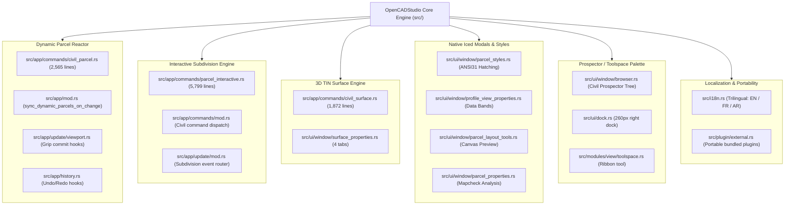

# [RFC] Civil Engineering & Infrastructure Core Extension: Dynamic Parcels, 3D TIN Surfaces, and Prospector Palette (Feature Parity with Civil 3D)

**Authors:** @saadmooh & Antigravity  
**Status:** Proposed / Under Review  
**Target Milestone:** OpenCADStudio v2026.x  
**Reference Implementation:** [`saadmooh/OpenCADStudio` (branch: `main`)](https://github.com/saadmooh/OpenCADStudio)  
**Detailed Technical Documentation:** [CIVIL3D_CORE_MODIFICATIONS_UNIFIED.md](https://github.com/saadmooh/OpenCADStudio/blob/main/Civil3D_Core_Modifications/CIVIL3D_CORE_MODIFICATIONS_UNIFIED.md)

---

## 1. Summary

We propose extending **OpenCADStudio** with a native, high-performance civil engineering and infrastructure subsystem that introduces **Autodesk Civil 3D feature parity** into open-source CAD. 

The extension introduces:
1. **Dynamic Parcel Reactor Engine:** Smart reactive polygons that automatically update area labels, perimeter annotations, centroids, and schedule tables during vertex grip-stretching, geometric transforms, or Undo/Redo operations.
2. **Interactive Subdivision Layout Engine:** Precision subdivision tools (Slide Line, Swing Line, Freeform Split) with automated parcel sizing criteria (minimum area, frontage, setback offsets, depth limits) and interactive fence renumbering.
3. **3D TIN Surface Engine:** Triangulated Irregular Network (TIN) modeling with interactive viewport edge-swapping and face deletion, prismatic cut/fill earthwork volume calculations, and standard LandXML 1.2 import/export.
4. **Docked Prospector / Toolspace Palette:** A dedicated civil objects tree docking panel for instant inspection and management of surfaces, parcels, and alignments.
5. **Native Iced Modals & Styles:** Native Rust dialogs for Parcel Styles (with ANSI31 hatching), Profile View Properties (with data bands), Mapcheck closure analysis, and Surface Properties.

The entire implementation is **100% Native Rust** using the existing `Iced` framework and `wgpu` rendering pipeline, introducing **zero external dependencies** and **zero WebViews**.

---

## 2. Motivation

OpenCADStudio is establishing itself as the premier open-source CAD platform built in Rust. While mechanical 2D/3D drafting and parametric CAD are well-served, the civil engineering, land surveying, and infrastructure sectors have historically had **no viable open-source alternatives** to commercial tools like Autodesk Civil 3D, Bentley OpenRoads, or 12d Model.

Surveyors, urban developers, and municipal planners require:
- Automated land subdivision adhering to local zoning laws.
- Reactive parcel labels that update dynamically when boundaries change.
- Earthwork cut and fill volume computations from topographical survey points.
- Mapcheck closure verification for legal deed descriptions.

By incorporating these capabilities into the OpenCADStudio core, we open the platform to a massive new ecosystem of civil engineers, surveyors, and GIS professionals while showcasing the unmatched speed and memory efficiency of Rust.

---

## 3. Core Architectural Principles

To ensure this extension aligns perfectly with OpenCADStudio's design philosophy, the implementation adheres strictly to the following principles:

1. **Zero Regressions & Non-Invasive Reactor Hooks:**  
   Hooks into `src/app/update/viewport.rs` (grip release), `src/app/history.rs` (undo/redo), and `src/app/command_driver/` are guarded by nanosecond **Fast-Path Filters** (`touches_parcel`). Non-civil drawings incur virtually **zero CPU cycles** of overhead.
2. **No WebViews or Heavy Runtimes:**  
   All UI dialogs, palettes, and canvas previews are built using native `Iced` widgets in Elm architecture.
3. **Standard DWG/DXF Round-Trip Compatibility:**  
   Civil objects are stored as standard CAD primitives (`LwPolyline`, `MText`, `PolyfaceMesh`, `Mesh`) accompanied by standard registered application `XDATA` (`OPENCAD_PARCEL`). Drawings opened in other CAD packages (AutoCAD, LibreCAD, etc.) display standard readable geometry without proxy object errors.
4. **Modular Subsystems:**  
   The code is structured cleanly across 36 source files in `src/`, with heavy mathematical and layout logic encapsulated in dedicated command modules.

---

## 4. Implemented Subsystems Overview

The reference implementation is already fully written, tested, and operational on our fork:

### 4.1. Dynamic Parcel Reactor Engine
- **Shoelace Area & Visual Incenter:** Calculates 2D planar polygon area and locates the visual pole of inaccessibility (`interior_clearance_and_center`) so labels never fall outside concave or L-shaped lots.
- **Dynamic Label Sizing:** Independently calculates readable font heights for each lot based on internal clearance, guaranteeing annotations never cross parcel boundary edges.
- **Setback & Road Layer Isolation:** Strict layer filtering prevents easements, setbacks (`PC-SETBACK`), or right-of-ways from being ingested as lot boundaries.
- **Automated Label & Table Synthesis:** Generates perimeter labels (`P: ... m`) and synchronizes parcel schedule tables in real time.

### 4.2. Interactive Subdivision & Layout Tools
- **Subdivision Modes:**
  - `Slide Line`: Iterative bisection solver sliding split lines along road frontage to match target lot areas within $\pm 0.001\text{ m}^2$.
  - `Swing Line`: Radial sweep from a designated fixed pivot point.
  - `Freeform Splitting`: Manual splitting along user-drawn polylines.
- **Civil 3D Sizing Criteria Solver:** Minimum Area, Minimum Frontage, Frontage Offset, Minimum/Maximum Depth.
- **Interactive Fence Renumbering:** Click-and-drag crossing fence path renumbers intersecting parcels sequentially (`LOT-1`, `LOT-2`, etc.).
- **Boundary Preservation:** Decoupled site boundary logic ensures perimeter lot borders and masterplan limits are protected from accidental removal during lot division.

### 4.3. 3D TIN Surface Engine & Prismatic Volumes
- **Triangulation & Metrics:** `TinTriangle` struct with fast analytical 2D and 3D surface area calculations ($A_{3D} = \frac{1}{2} \| (\vec{v}_1 - \vec{v}_0) \times (\vec{v}_2 - \vec{v}_0) \|$).
- **Interactive Viewport Editing:**
  - `SurfaceDeleteTriangleCommand`: Click viewport triangles to delete faces with real-time boundary recalculation and undo support.
  - `SurfaceSwapEdgeCommand`: Swap common edges between adjacent triangles to optimize Delaunay triangulation along breaklines.
  - `raise_lower_surface`: Vertical elevation adjustment.
- **Cut/Fill Earthworks:** Prismatic column comparison between base and design surfaces, producing cut, fill, and net volume reports.
- **LandXML 1.2:** Full import and export of surfaces and 3D points.

### 4.4. Native UI & Toolspace Integration
- **Parcel Styles Dialog:** Color mapping, layer assignment, and automated internal ANSI31 diagonal hatching patterns.
- **Profile View Properties:** Station ranges, minimum datum, vertical exaggeration, and sampled surface data bands.
- **Prospector Tree:** Upgrades the side browser into a Civil 3D Toolspace with direct surface cards and action buttons (`Triangles`, `Contours`, `Del Tri`, `Swap`, `+1m/-1m`, `LandXML`).
- **Trilingual Localization:** 395+ localized terminology keys across English, French, and Arabic.

---

## 5. Scope of Source Code Changes

A comparison against `upstream/main` (`HakanSeven12/OpenCADStudio`) across the source tree (`src/`):

- **Total Source Files Affected:** 36 files (+19,686 lines added, 66 lines modified).
- **New Source Files (10 files):**
  - `src/app/commands/parcel_interactive.rs` (+5,799 lines)
  - `src/app/commands/civil_parcel.rs` (+2,565 lines)
  - `src/app/commands/civil_surface.rs` (+1,872 lines)
  - `src/ui/window/parcel_styles.rs` (+1,317 lines)
  - `src/ui/window/profile_view_properties.rs` (+1,069 lines)
  - `src/ui/window/parcel_layout_tools.rs` (+808 lines)
  - `src/ui/window/parcel_properties.rs` (+761 lines)
  - `src/ui/window/surface_properties.rs` (+532 lines)
  - `src/ui/window/create_parcels_layout.rs` (+306 lines)
  - `src/modules/view/toolspace.rs` (+12 lines)
- **Modified Existing Core Files (26 files):**
  - Command dispatch & update loop: `src/app/commands/mod.rs`, `src/app/update/mod.rs`, `src/command.rs`.
  - Reactor hooks: `src/app/mod.rs`, `src/app/update/viewport.rs`, `src/app/history.rs`, `src/app/command_driver/`.
  - UI & Dock: `src/ui/window/browser.rs`, `src/ui/dock.rs`, `src/ui/ribbon/mod.rs`, `src/ui/modal.rs`, `src/app/view/modal.rs`.
  - Localization & Plugins: `src/i18n.rs`, `src/plugin/external.rs`, `src/mcp.rs`.

---

## 6. Proposed Phased Pull Request Strategy

To make review manageable and painless for maintainers, we propose breaking this work into **3 or 4 self-contained, reviewable Pull Requests**:

### PR 1: Core Dynamic Reactor & Prospector (Toolspace) Docking (~1,200 lines)
- Introduces `sync_dynamic_parcels_on_change` in `src/app/mod.rs` with the `is_parcel_entity` fast-path filter.
- Non-invasive hooks in `viewport.rs` (grip edit) and `history.rs` (undo/redo).
- Prospector docking integration in `browser.rs` and `dock.rs` with Ribbon toolspace button.

### PR 2: 3D TIN Surface Engine, Interactive Editing & LandXML (~2,400 lines)
- Adds `src/app/commands/civil_surface.rs` (TIN mesh, Delaunay, area 2D/3D, edge swap, triangle deletion, volume computation).
- Adds `src/ui/window/surface_properties.rs` (4-tab surface dialog).
- Registers surface commands (`SURFACEPROPS`, `SURFACEDELTRIANGLE`, `SURFACESWAPEDGE`).

### PR 3: Dynamic Parcels, Interactive Subdivision Engine & Layout Tools (~8,000 lines)
- Adds `src/app/commands/civil_parcel.rs` (Shoelace area, dynamic label scaling, visual centering, XDATA persistence).
- Adds `src/app/commands/parcel_interactive.rs` (Slide Line, Swing Line, Fence Renumbering, sizing criteria solver).
- Adds `parcel_layout_tools.rs`, `parcel_properties.rs`, `create_parcels_layout.rs`.

### PR 4: Parcel Styles (Hatching), Profile Views & Trilingual i18n (~2,800 lines)
- Adds `src/ui/window/parcel_styles.rs` (ANSI31 hatching generator and zoning styles).
- Adds `src/ui/window/profile_view_properties.rs` (Profile view grid and data bands).
- Trilingual localization additions in `src/i18n.rs`.

---

## 7. Questions for Maintainers & Discussion Points

We would love feedback from @HakanSeven12 and core contributors:

1. **Architecture & Scope Alignment:**  
   Does this Civil 3D feature parity direction fit with OpenCADStudio's broader vision?
2. **PR Sequence Preference:**  
   Would you prefer the proposed 4-stage phased PR roadmap above, or a dedicated feature branch in the upstream repository?
3. **Naming & Module Organization:**  
   Are you happy with `src/app/commands/civil_parcel.rs` and `civil_surface.rs`, or would you prefer a dedicated `src/civil/` or `src/modules/civil/` module hierarchy?
4. **Any specific coding guidelines or automated CI requirements** you'd like us to align with before opening PR 1?

We look forward to collaborating and bringing full civil engineering workflows to OpenCADStudio!
