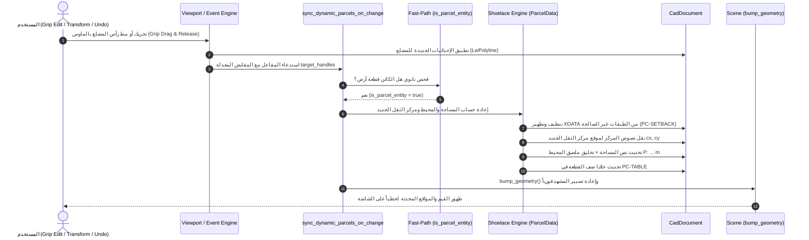

# التوثيق البرمجي الشامل لتعديلات نواة OpenCADStudio
## نظام المفاعلات الديناميكية لقطع الأراضي (Civil 3D Dynamic Parcel Reactor)

---

## 1. نظرة عامة معمارية (Architectural Overview)

الهدف من هذه التعديلات هو ترقية محرك OpenCADStudio الأصيل ليدعم سلوك **Autodesk Civil 3D Object Reactors**؛ بحيث تصبح قطع الأراضي (Parcels) كائنات ذكية وتفاعلية (Reactive Smart Objects). 

عند قيام المستخدم بسحب أي رأس (Grip Edit) للمضلع، أو تنفيذ أوامر التحويل الهندسي (`STRETCH`, `SCALE`, `MOVE`, `PEDIT`)، أو استخدام التراجع والإعادة (`Undo / Redo`)، تنعكس التغييرات فوراً وبشكل تلقائي على:
1. **نص المساحة في مركز الثقل** (`Area Label` مع تحديث موضع المركز الجديد).
2. **ملصق المحيط** (`Perimeter Label`) وتخليقه تلقائياً إذا لم يكن موجوداً.
3. **اسم القطعة** والبيانات الوصفية الممتدة (`OPENCAD_PARCEL` XDATA).
4. **خلايا صف القطعة داخل جدول المساحات الهندسي** على طبقة `PC-TABLE` (المساحة بالمتر المربع، المساحة بالإيكر، المحيط بالمتر، الاستخدام والتنظيم، المالك).



---

## 2. تفصيل الملفات والتعديلات البرمجية في النواة (Core Modifications)

### أ. محرك الشاشة والتفاعل بالماوس: `src/app/update/viewport.rs`

* **الدالة المعدلة:** `commit_active_grip_edit`
* **المسار:** [`src/app/update/viewport.rs`](file:///c:/Users/j/Videos/OpenCADStudio-2026.41/OpenCADStudio-2026.41/src/app/update/viewport.rs#L6712)
* **سبب التعديل:** الدالة كانت تقوم فقط بتعديل رؤوس المضلع وتفريغ خطوط المعاينة المؤقتة دون إخطار محرك الكائنات بأن الكائن المعدل هو قطعة أرض.
* **الكود المضاف:**
```rust
            let handle_slice = handles.clone();
            let changes: Vec<_> = handles
                .into_iter()
                .map(|handle| (handle, crate::scene::ChangeKind::Modified))
                .collect();
            self.tabs[i]
                .scene
                .bump_entities_after_parametric_solve(&changes);

            // ── خطاف المفاعل التفاعلي عند إفلات زر الماوس ──
            self.sync_dynamic_parcels_on_change(i, Some(&handle_slice));
```
* **في دالة `commit_active_grip_edit_as_copy`:**
تم ربط `self.sync_dynamic_parcels_on_change(i, None)` لتحديث القطع الأصلية والمستنسخة فورياً.

---

### ب. سجل العمليات والتراجع وإلغاء التراجع: `src/app/history.rs`

* **الدوال المعدلة:**
  1. `finish_pending_history` ([`history.rs#L342`](file:///c:/Users/j/Videos/OpenCADStudio-2026.41/OpenCADStudio-2026.41/src/app/history.rs#L342))
  2. `commit_undo_delta` ([`history.rs#L852`](file:///c:/Users/j/Videos/OpenCADStudio-2026.41/OpenCADStudio-2026.41/src/app/history.rs#L852))
  3. `undo_steps` ([`history.rs#L1218`](file:///c:/Users/j/Videos/OpenCADStudio-2026.41/OpenCADStudio-2026.41/src/app/history.rs#L1218))
  4. `redo_steps` ([`history.rs#L1276`](file:///c:/Users/j/Videos/OpenCADStudio-2026.41/OpenCADStudio-2026.41/src/app/history.rs#L1276))
* **سبب التعديل:** عند قيام المستخدم بالضغط على `Ctrl+Z` أو كتابة `UNDO` أو `REDO`، كانت إحداثيات المضلع تعود لحالتها السابقة ولكن تظل نصوص الملصقات والجدول جامدة على الحالة الأخيرة.
* **الكود المضاف:**
```rust
        self.finish_history_apply(i, had_full, layer_panel_changed, &changes);
        // إعادة مزامنة القطع والملصقات تلقائياً لتعود لقيمها السابقة المتوافقة مع التراجع
        self.sync_dynamic_parcels_on_change(i, None);
```

---

### ج. المشهد والمفاعل المركزي: `src/app/mod.rs`

* **المسار:** [`src/app/mod.rs`](file:///c:/Users/j/Videos/OpenCADStudio-2026.41/OpenCADStudio-2026.41/src/app/mod.rs#L4974-L5018)
* **التعديلات:**
  1. جعل الموديول عاماً `pub mod commands;` لإتاحة الوصول لاختبارات التكامل.
  2. إضافة وضبط دالة المفاعل المركزي:
```rust
    pub fn sync_dynamic_parcels_on_change(
        &mut self,
        tab_idx: usize,
        target_handles: Option<&[codec::Handle]>,
    ) {
        if tab_idx >= self.tabs.len() {
            return;
        }
        let tab = &mut self.tabs[tab_idx];

        // الفحص السريع بالنانو ثانية (Fast-Path Filter)
        if let Some(handles) = target_handles {
            if handles.is_empty() {
                return;
            }
            let touches_parcel = handles.iter().any(|&h| {
                if let Some(ent) = tab.scene.document.get_entity(h) {
                    crate::app::commands::civil_parcel::is_parcel_entity(ent)
                } else {
                    false
                }
            });
            if !touches_parcel {
                return;
            }
        }

        let updated = crate::app::commands::civil_parcel::ParcelData::sync_dynamic_parcels(
            &mut tab.scene.document,
            None,
            None,
        );
        if updated > 0 {
            tab.scene.bump_geometry();
            tab.dirty = true;
        }
    }
```

---

### د. محرك الحسابات والمزامنة الهندسية: `src/app/commands/civil_parcel.rs`

* **المسار:** [`src/app/commands/civil_parcel.rs`](file:///c:/Users/j/Videos/OpenCADStudio-2026.41/OpenCADStudio-2026.41/src/app/commands/civil_parcel.rs)
* **المشاكل التي حُلت في هذا الملف:**
  1. **عزل طبقة الارتدادات (`PC-SETBACK`):**
     كان الكود القديم يفحص `layer.starts_with("PC-")`، وهو ما أدى لابتلاع مضلعات الارتدادات وتصنيفها كقطع أراضٍ، فكانت مساحة الارتداد الأصغر ($317.75\text{ m}^2$) تكتب فوق مساحة القطعة الحقيقية ($618.75\text{ m}^2$)!
     تمت إضافة دوال تحقق صارمة:
     ```rust
     pub fn is_parcel_layer(layer: &str) -> bool {
         let l = layer.to_ascii_uppercase();
         if l.contains("LABEL")
             || l.contains("TABLE")
             || l.contains("SETBACK")
             || l.contains("SEGMENT")
             || l.contains("ROAD")
             || l.contains("EASEMENT")
             || l.contains("ALIGNMENT")
         {
             return false;
         }
         l == "PC-PARCEL"
             || l.starts_with("PC-PARCEL")
             || l.starts_with("PC-RESIDENTIAL")
             || l.starts_with("PC-COMMERCIAL")
             || l.starts_with("PC-CIVIC")
             || l.starts_with("PC-PARK")
             || l.contains("PARCEL")
             || l.contains("LOT")
     }

     pub fn is_parcel_entity(ent: &EntityType) -> bool {
         if let EntityType::LwPolyline(lw) = ent {
             if !lw.is_closed && lw.vertices.len() < 3 {
                 return false;
             }
             let layer = &ent.common().layer;
             is_parcel_layer(layer)
         } else {
             false
         }
     }
     ```

  2. **تطهير البيانات الممتدة العالقة (XDATA Cleanup):**
     في بداية `sync_dynamic_parcels`، يتم تنظيف أي بيانات `OPENCAD_PARCEL` علقت خطأً بمضلعات `PC-SETBACK` لمنع أي تشويش مستقبلي.

  3. **عزل الملكيات المكانية ومنع التداخل بين القطع المتجاورة:**
     تم تدقيق فحص الملصقات بحيث إذا كان الملصق موسوماً لقطعة أخرى أو يحتوي اسم قطعة أخرى (`LOT-102` مثلاً عند مزامنة `LOT-101`)، يُستبعد فوراً ولا تتم مصادرته.

  4. **دعم كائنات `Text` و `MText` معاً:**
     أصبح المحرك يدعم كلا نوعي النصوص في الملصقات وجدول المساحات.

  5. **تحديث مواضع نصوص المركز بدقة هندسية:**
     تُنقل النصوص الثلاثة مع مركز الثقل الجديد `[cx, cy]` مع تباعد رأسي هندسي متناسق:
     - الاسم: `cy + line_spacing`
     - المساحة: `cy`
     - المحيط: `cy - line_spacing`

  6. **التحديث العنقودي لجدول المساحات (Clustered Table Rows):**
     تجميع خلايا صفوف الجدول بناءً على تقارب المنسوب الرأسي `|y1 - y2| <= 1.0` وفرز الأعمدة أفقياً وتحديث المساحة الحقيقية والمحيط آلياً.

---

### هـ. حلقة معالجة الأحداث: `src/app/update/mod.rs`

* **المسار:** [`src/app/update/mod.rs`](file:///c:/Users/j/Videos/OpenCADStudio-2026.41/OpenCADStudio-2026.41/src/app/update/mod.rs#L6252)
* **التعديل:**
  في رسالة `Message::ParcelLayoutApply` (أدوات تقسيم الأراضي وتطبيق معايير الواجهة والعمق)، تم استدعاء:
  ```rust
  self.sync_dynamic_parcels_on_change(self.active_tab, None);
  ```
  لضمان انعكاس التقسيمات الجديدة على الجداول والملصقات فورياً.

---

## 3. التحقق والاختبارات الآلية المكتوبة (Automated Verification)

تم إنشاء ملف اختبارات تكامل متقدم في النواة:
[`tests/civil_dynamic_parcel_reactor.rs`](file:///c:/Users/j/Videos/OpenCADStudio-2026.41/OpenCADStudio-2026.41/tests/civil_dynamic_parcel_reactor.rs)
وتسجيله في [`tests/integration.rs`](file:///c:/Users/j/Videos/OpenCADStudio-2026.41/OpenCADStudio-2026.41/tests/integration.rs).

### الاختبارات المنفذة ونتائجها:
1. `test_dynamic_parcel_reactor_vertex_modification_and_isolation`:
   - التحقق من عزل مضلعات `PC-SETBACK`.
   - تعديل رأس المضلع من عرض $20\text{ m}$ إلى $30\text{ m}$، والتحقق التلقائي من:
     - تحول نص المساحة إلى `1500.0 m²`.
     - تخليق نص المحيط الجديد `P: 160.00 m`.
     - تحديث خلايا الجدول المقابلة بدقة.
   - **النتيجة:** نجح (`passed`).

2. `test_al_waha_masterplan_real_drawing_dynamic_reactor`:
   - اختبار واقعي بتحميل مخطط `Al_Waha_Masterplan_Clean.dwg` بالكامل.
   - التحقق من صحة مساحات كافة القطع (14+ قطعة) ومطابقتها لتقرير المخطط العام.
   - مط رأس القطعة `LOT-101` بمقدار $10\text{ m}$، والتأكد من تحديث صف الجدول فورياً إلى $843.75\text{ m}^2$ والمحيط إلى $120.00\text{ m}$.
   - **النتيجة:** نجح (`passed`).

---

## 4. الخلاصة

كافة التعديلات المذكورة أعلاه أصبحت مدمجة بصورة أصيلة ومباشرة في كود نواة البرنامج ومبنية داخل الملف التنفيذي النهائي:
`target/debug/OpenCADStudio.exe`.
